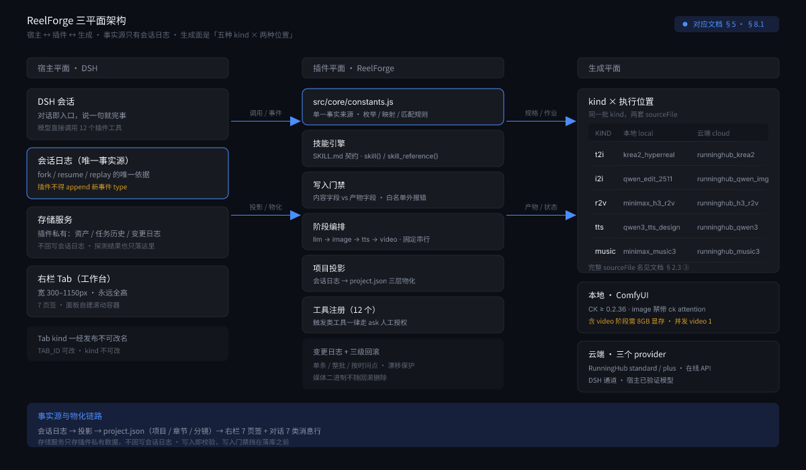
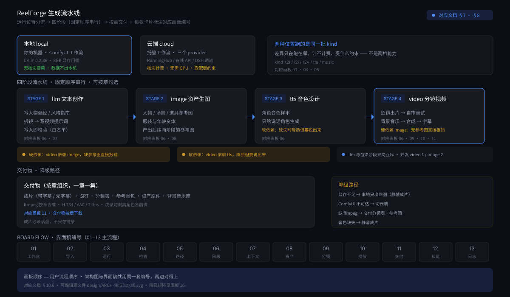

# ReelForge 设计方案

> 在 DSH（DeepSeek Harness）内复刻 [SwotAtmk/infinite-creation](https://github.com/SwotAtmk/infinite-creation) 的「小说/剧本 → 漫剧/短视频」全链路能力，作为 **DSH 插件**交付，用户在 DSH 对话里直接使用，**不需要单独安装任何应用**。

| 项 | 值 |
| --- | --- |
| 插件名 | `reelforge`（npm 包名 `@local/reelforge`） |
| 形态 | DSH 插件（Host 行 + Client 行 + Bundle 补丁） |
| 交付物 | **本文档（设计方案，不含实现代码）** + `design/` 下 **19 张设计稿**（17 张界面稿 + 2 张架构图，SVG 源文件 + PNG 成图 + `.figcraft` 设计文件） |
| 日期 | 2026-10-22 |
| 参照源 | [SwotAtmk/infinite-creation](https://github.com/SwotAtmk/infinite-creation)（MIT）、`deepseek-harness` 宿主仓库内置 `cordis-plugin-development` 技能 |

---

## 0. 摘要

**要解决的问题**：infinite-creation 是一套完整的本地 AI 漫剧/短视频生产系统（Next.js 应用 + 内置 openclaude Agent 内核 + 35 个 Skill + ComfyUI 工作流体系），但它要求用户**克隆仓库、`pnpm install`、自备 ComfyUI、起一个 4600 端口的常驻服务**，再点界面。用户想要的是**在 DSH 里直接说「把这个小说改成短剧」就完事**。

**核心判断**：infinite-creation 的价值不在于「它是个独立应用」，而在于它**自己就把这件事写成了官方用法**——它的 `SKILL.md` 第三节标题是「**全链路流程（可脱离本项目复刻的方法论）**」，明说：

> 不启动本项目时，Agent 可照此流程 + `skills/` 技能库，在任意环境实现同样的「小说 → 视频」。

**ReelForge 就是这个「脱离本项目复刻」的用法，只是宿主从任意环境换成了 DSH。** 所以复刻的对象很清楚：

- **复刻**它的**方法论与契约**：四阶段流水线（`llm` 文本创作 → `image` 资产生图 → `tts` 音色设计 → `video` 分镜视频）、一致性锚点三件套（`bible` 人物圣经 / `style` 风格指南 / `continuity` 连续性记录）、**工作流规格契约**（`roles` / `media` / `outputs` / `prune`）、**技能引擎契约**（`SKILL.md` frontmatter + 路由 + 技能工厂）、**写入门禁**（内容字段白名单 vs 产物字段）、**变更日志与回滚**。
- **不复刻**它的**外壳**：Next.js 全屏应用、SQLite + 30+ HTTP 端点、内置 openclaude Agent 内核、`start-infinite-creation.bat` 常驻服务、ComfyUI 一键整合包。

**为什么不需要它的 Agent 内核**：infinite-creation 自己区分「内置 openclaude」与「外部 Agent 运行时（Claude Code / Codex CLI / Gemini CLI / … 经本地 MCP 工具桥接管流水线）」两档。**DSH 天然就是那档「外部 Agent 接管」**——DSH 自己就是 Agent 宿主，插件注册的工具直接被 DSH 的模型调用。于是 ReelForge **不需要 ReAct 循环、不需要 LLM SDK、不需要看门狗**，省掉整个 `lib/agent/agent-loop.js` + `openclaude-agent.js` + `job-runner.js`（合计约 5.7 万字符）。这是 DSH 宿主带来的**净减法**，不是妥协。

**一句话**：**ReelForge = infinite-creation 的「可脱离复刻」方法论，装进 DSH 的对话与右栏里，让 DSH 当那个 Agent 运行时。**

### 0.1 与前一版方案（参照 Toonflow）的关键差异

| 维度 | Toonflow 路线（作废） | infinite-creation 路线（现行） |
| --- | --- | --- |
| 产物单位 | 一条 30 秒短剧 | **项目 → 章节 → 分镜 → 成片**，不限时长 |
| 创作主体 | 插件提供 provider，模型只写分镜 | **Skill 驱动**：模型按技能规范写剧本/分镜/提示词，插件只管**执行与固化** |
| 生成后端 | DSH 模型通道为主 | **本地 ComfyUI 工作流**为主，云端 RunningHub 为辅（同一套规格换执行位置） |
| 一致性 | 「角色定妆图 + 全能参考兜底」 | **`bible` + `style` + `continuity` 三件套 + canonical 参考图 + 参考标签规则** |
| 音频 | 方案里的一个分支 | **独立阶段**：音色设计（TTS）+ 背景音乐（MonoMax Music3）+ 字幕烧录/SRT |
| 扩展机制 | 无 | **技能引擎 + 技能工厂**（工作流 JSON → 规格 → `SKILL.md`） |
| 写入安全 | 无 | **内容字段 vs 产物字段白名单 + 变更日志 + 回滚** |

---

## 1. 背景与目标

### 1.1 目标

| # | 目标 | 验收口径 |
| --- | --- | --- |
| G1 | 用户在 DSH 对话中用自然语言发起创作 | 「把这本小说改成短剧」能跑通全流程 |
| G2 | 产出**章节化结构**：项目 → 章节 → 分镜 | 长小说自动拆章；每章独立分镜与成片 |
| G3 | 产出**一致性锚点**三件套 | `bible`（人物圣经）/ `style`（风格指南）/ `continuity`（连续性）可读可改 |
| G4 | 产出**结构化分镜** | schema 校验通过；**写入即校验**（时长/台词速度/说话人数当场拒） |
| G5 | 产出**资产库**（10 类） | 人物/场景/道具/服装/年龄/语音/音乐/音效/视频/其他；服装与年龄按 `parent_id` 挂到角色 |
| G6 | 产出**成片 + 字幕 + 分镜表 + 参考图包** | 成片带烧录字幕与无字幕两版，另出 SRT；分镜表与参考图包可直接下载 |
| G7 | **阶段可勾选、可续跑** | `llm`/`image`/`tts`/`video` 四阶段任意组合执行；进程崩溃后可续跑且不重复生成 |
| G8 | **可回滚** | 内容写入有变更日志，支持单条/整批/按时间点回滚，带漂移保护 |
| G9 | **零单独安装** | 装一个 DSH bundle 即可用；**云端模式下不需要 ComfyUI、不需要任何本地服务** |

### 1.2 非目标（明确不做）

| 非目标 | 理由 |
| --- | --- |
| Next.js 全屏应用 + HTTP API 服务 | 我们有 DSH 的右栏面板与对话；起 4600 端口的服务就是「单独安装」的反面 |
| 内置 Agent 内核（ReAct 循环 / LLM SDK / 看门狗） | DSH 就是 Agent 运行时（§0），自研等于重复造轮子 |
| SQLite 数据库 | DSH 硬规则 R2：插件私有数据走**存储服务**；且 DSH 会话日志才是事实源 |
| ComfyUI 一键整合包 / 模型下载 | 用户自备，本插件只**探测**不**分发** |
| 技能市场 / 插件上传 | 扩展点归 DSH 插件体系与本地 `skills/` 目录 |
| 无限画布式的节点画布 | 宿主右栏容器 `overflow:hidden`、宽 300–1150px、永远全高，画布交互必然残废（§3.2） |
| 3D 导演台 | 宿主无 3D 模块；成本不成立 |
| 21 种界面语言 | DSH 的 locale 接管；只做 zh + en |
| 自建模型中转平台 | 用 DSH 侧模型通道 + 用户自配 provider 替代 |

### 1.3 「不用单独安装」的准确含义

这条约束现在有个**关键张力**，必须写清楚：

> infinite-creation 的「本地运行」**必须**先装 ComfyUI + 各种模型。这跟「零单独安装」直接冲突吗？

**不冲突，但前提是「本地」是可选增强，不是使用前提。** ReelForge 的运行位置分两档，**云端档不需要用户机器上装任何东西**：

| 档位 | 用户机器要什么 | 装什么 | 能力 |
| --- | --- | --- | --- |
| **云端**（默认） | 只要 DSH 在跑 | 无 | RunningHub / 在线 API 跑同一套工作流规格 |
| **本地**（可选） | ComfyUI + 对应模型 | 用户自己装 | 同样的工作流规格跑在本机，数据不出本机 |

所以「零单独安装」的准确含义是：**装一个 DSH bundle 就能用，不必装 ReelForge 这套应用**。用户若想用本地 ComfyUI，那是**他本来就有的生成环境**，不是我们强加的依赖。这条正好落在画板 `03-RF-RunMode` / `04-RF-DeviceCheck` 上：**先选位置，本地才需要过设备检查**。

**推论**：ReelForge 不需要 `apps/server`、不需要 `apps/desktop`、不需要 `start-infinite-creation.bat`。它只需要 **一个 Host 插件 + 一个 Client 插件 + 一个 bundle 补丁**，随 DSH profile 走。

---

## 2. 源系统分析：infinite-creation 是什么

### 2.1 能力盘点（已核对 README、SKILL.md 与仓库树）

infinite-creation 是面向漫剧/短视频的本地全链路 Agent 生产系统：Node.js ≥ 22（Next.js 15 + React 18 自定义 server，单端口 4600）+ `node:sqlite` + ComfyUI REST/WebSocket + ffmpeg，**零原生编译依赖**。MIT 协议，103 star / 28 fork，2026-09-09 开源，**至今仍在日更**。

一句话定位（仓库自己的 tagline）：**「把你的故事变成亿帧画面」**——提交小说/剧本，本地 ComfyUI-MiniMaxH3 + Agent + Skill 技能全自动无限生产视频，**不限时长**。

核心能力十块：

1. **无限视频时长** —— 上传小说/剧本自动拆章，每章独立分镜、独立成片，不受单条时长限制。
2. **自动分镜** —— 按人物动作/场景变化/道具移动自动拆镜，**长镜头聚合**（同一场景连续动作 + 多句对白合并，禁止一句一镜）。
3. **四阶段流水线** —— `llm` 文本创作 → `image` 资产生图 → `tts` 音色设计 → `video` 分镜视频，可**任意勾选组合**执行。
4. **一致性锚点三件套** —— `bible` 人物圣经 / `style` 风格指南 / `continuity` 连续性记录。
5. **技能系统** —— 35 个 `SKILL.md`，按关键词路由，未命中走 `novel-to-video` 总流水线兜底。
6. **技能工厂（自迭代）** —— 上传 ComfyUI 工作流 JSON → 解析节点 → 推导规格 → LLM 起草 `SKILL.md` → Agent 立即可调用。
7. **自定义工作流接入** —— 四类 `kind`（`t2i` / `i2i` / `r2v` / `tts`，外加 `music`），用户自己的 ComfyUI 工作流可替代默认工作流。
8. **外部 Agent 运行时** —— 内置 openclaude 之外，可切到本机 CLI Agent（Claude Code / Codex CLI / Gemini CLI / Qwen Code / Cursor Agent / Qoder CLI / Grok Build / Hermes / 自定义命令），经**本地 MCP stdio 工具桥**接管流水线。
9. **断点续跑 + 幂等跳过** —— 任务持久化，进程崩溃/重启后继续，不重复生成。
10. **审查/重生成 + 变更日志 + 回滚** —— 分镜级预览与重生成；内容写入有 DB 层行快照，支持单条/整批/按时间点回滚。

工程底座：内置 openclaude 内核（进程内 SDK）+ 工具注册表 + 技能引擎 + 技能工厂、`workflows/` 工作流模板库（MiniMax H3 / Qwen-Image 2.1 / Krea2 / Qwen3-TTS / MiniMax Music3，含 GGUF 量化版与 RunningHub 云端版）、`lib/agent/external/` 的 MCP 工具桥、WebSocket 进度推送、`/files` 静态托管与 Range 流式播放。

### 2.2 架构

```text
infinite-creation/
├── app/                 # Next.js App Router（页面 + 30+ API 端点）
├── lib/
│   ├── core/            # ComfyUI / LLM / DB / ffmpeg / 工作流规格 / 变更日志
│   ├── agent/           # agent-loop / openclaude / job-runner / stages / skill-engine / tools / guard
│   │   └── external/    # 外部 Agent：defs / registry / detect / mcp-config / mcp-server / runner
│   └── shared/          # 纯常量与类型约定（枚举、枚举映射、命名匹配、拆章、硬件预设）
├── server.js            # 自定义 server：WS 进度推送 + /files 静态托管（Range 流式）
├── workflows/           # ComfyUI 工作流模板（本地版 + RunningHub 云端版 + GGUF 量化版）
├── skills/              # 35 个技能（各一份 SKILL.md + 可选 references/）
├── harness-skills/      # ic-writer：给外部 AI 编程工具的「只写文本」写入技能
├── scripts/             # install-skills / install-writer-skill
├── tests/               # 单元测试 + 外部 Agent 定义/MCP 握手测试
└── vendor/openclaude/   # Agent 内核源码（第三方，不在 MIT 授权范围）
```

**注意 `lib/shared/index.js` 的地位**：它是**纯数据、无运行时依赖**的单一事实来源——资产分类、参考图白名单、分辨率枚举与映射表、视频宽高比、角色名匹配规则、`CONTEXT_KEYS`、分镜/任务状态枚举、**小说拆章算法**、**硬件预设**、Agent 看门狗阈值、上传体积上限。**工作流映射表、写入校验、界面下拉三处全部引用这一份**，并有一条单测盯着三者不许漂移。这是 ReelForge 必须照抄的工程纪律（§6.1）。

### 2.3 可直接借用的契约（本方案的骨架来源）

下面五份契约是 infinite-creation 最有价值的部分，**应当借用到 ReelForge**：

**① 四阶段流水线契约** —— 复刻成 ReelForge 的阶段模型与工作台勾选：

| 阶段 | 做什么 | 依赖 | 产出 |
| --- | --- | --- | --- |
| `llm` 文本创作 | 写人物圣经/风格、资产提示词、拆分镜、写视频提示词 | LLM | 大纲、`bible`/`style`、分镜、prompt |
| `image` 资产生图 | 人物/场景/道具出图 | ComfyUI `t2i`/`i2i` | 角色三视图、场景图、道具图、服装/年龄变体 |
| `tts` 音色设计 | 人物音色样本 | ComfyUI `tts` | 每个角色的 `voice_ref` |
| `video` 分镜视频 | 逐镜出带语音视频 + 合并 | ComfyUI `r2v` + ffmpeg | 分镜视频、成片 |

**② 一致性锚点三件套** —— `bible.md` / `style.md` / `continuity.md`，落盘在 `context/*.md`，键名固定为 `['bible','style','continuity']`：

- `bible`：每个角色唯一外貌/配色/声音 + 衣橱。
- `style`：统一画风/光线/色调/镜头语言。
- `continuity`：连续性记录。

**③ 工作流规格契约（Workflow Spec）** —— 这是 provider 层的真正形状，比「图像 provider / 视频 provider」两个接口精细得多。规格由**四组字段**组成：

**（a）规格头**：`id`（唯一 id）、`kind`（五种之一）、`name`、`description`、`sourceFile`（`workflows/` 下的模板文件名）、`outputs`（产物节点的 `class_type` 列表）、`prune`（需删除的节点 id，模板自带的硬编码占位链）。

**（b）`roles` —— 语义角色 → ComfyUI 节点的映射表**（每项 = 节点 + 字段名，可选 `map` 做枚举翻译）：

| 语义角色 | 用途 | 备注 |
| --- | --- | --- |
| `positive_prompt` | 正向提示词 | 字段名可能是 `text` 或 `prompt` |
| `negative_prompt` | 负向提示词 | 节点字段名需匹配 `/neg\|negative\|负向\|负面/` |
| `width` / `height` | 出图尺寸 | 通常在 `Empty*Latent` 节点上 |
| `seed` | 随机种子 | 字段可能是 `seed` 或 `noise_seed` |
| `seconds` | 视频时长 | 仅当全图存在其一才推导 |
| `resolution` | 分辨率档位 | `map` 把标签翻译成 megapixels |
| `aspect_ratio` | 画幅 | `map`：`9:16` → `9:16 (Portrait Widescreen)` |
| `image` | 图生图参考图 | 指向第一个 image loader |
| `filename_prefix` | 产物文件名前缀 | |
| `text` / `voice_description` | `tts` 的台词与音色描述 | |
| `caption` / `lyrics` / `max_duration` | `music` 的三要素 | |

**（c）`media` —— 参考素材绑定**（`r2v` 必需）：

| 字段 | 含义 |
| --- | --- |
| `targetNode` | 绑定目标节点 |
| `mediaField` / `typeField` | 字段名前缀，默认 `media_` / `media_type_` |
| `fieldsByType` | 按类型各自编号（`image` / `audio` / `video` / `videoAudio`），对应 H3 的四组 Autogrow 输入 |
| `loaders` | 可复用的 loader 节点模板（`image` / `audio` / `video` 各一组） |
| `reusePool` | 优先复用的模板节点 id 列表 |
| `maxImages` | 参考图上限（H3 为 **9**） |
| `maxAudioVideo` | 音视频上限（H3 为 **3**） |

**（d）`prune`** —— 见下方「`prune` 的语义」。

**关键认识**：`kind` 只有五种（`t2i` / `i2i` / `r2v` / `tts` / `music`），**本地与云端是同一批 kind 的两套 `sourceFile`**：

| kind | 本地（ComfyUI） | 云端（RunningHub） |
| --- | --- | --- |
| `t2i` | `krea2_hyperreal_t2i`（N 卡）/ `qwen_image_2_1_t2i_gguf`（AMD） | `runninghub_krea2_t2i` |
| `i2i` | `qwen_image_edit_2511_i2i` / `qwen_image_2_1_i2i_gguf` | `runninghub_qwen_image_edit_2511_i2i` |
| `r2v` | `minimax_h3_r2v` / `minimax_h3_r2v_gguf` | `runninghub_minimax_h3_r2v` |
| `tts` | `qwen3_tts_voice_design` | `runninghub_qwen3_tts_voice_design` |
| `music` | `minimax_music3`（int8 量化） | `runninghub_minimax_music3`（fp16） |

⇒ **「本地 vs 云端」不是「能力集不同」，而是「同一批工作流规格跑在哪台机器上」。** 这直接修正了画板 `03-RF-RunMode` 的前提（见 §10.6.3）。

**④ 技能引擎契约** —— `SKILL.md` = YAML frontmatter（`name` + `description`）+ 可选 `references/`。路由按任务关键词；未命中走 `novel-to-video` 总流水线兜底。Agent 侧两个工具：`skill(name)` 读技能正文、`skill_reference(name, ref)` 读单个参考文件。技能来源三类：`bundled` / `installed` / `generated`。

**⑤ 写入门禁契约** —— 「内容字段」与「产物字段」严格分离（§6.5 详述）。这条是 infinite-creation 里**最值得抄的工程决策**：它保证了外部写入方**无法伪造「已生成」状态**，也保证了「写入合法但几分钟后才在渲染阶段炸」这种错误离写入点太远的问题不会发生。

**⑥ 参考素材装配契约** —— 一个分镜的参考素材有**固定顺序与上限**：

- 顺序：**人物图 → 场景图 → 道具图 → 人物语音**。
- 角色参考图优先级：**服装 > 年龄变体 > 角色原图**（服装与年龄是两个独立维度，**不叠加**）。
- 标签格式：`角色名（服装名）` / `角色名（人物形象）` / `场景名（场景背景）` / `道具名（道具）`。
- 音频参考：**只有说话的角色才引用音色**；图片上限 **9 张**、音视频上限 **3 段**（H3 节点硬上限）。
- 说话人匹配必须**规范化后精确相等**，不能用 `includes` 包含匹配（「明」会被「小明」误伤，导致错挂音色并挤掉音频名额）。规范化只剥离括号内的身份后缀与分隔符。

### 2.4 许可

**MIT**（Copyright (c) 2026 SwotAtmk），商用与二次开发均可，**必须保留原版声明**。

> ⚠️ **但仓库自己划了三条授权边界，复刻时必须逐条核对**：
>
> 1. `skills/` 目录中**部分技能来源于 MiniMax-H3 官方仓库**，**不在本项目的 MIT 授权范围**，须遵循其各自授权条款。
> 2. `vendor/` 目录为**第三方代码**（openclaude 内核、VS Code 扩展、Astro 官网），**不在 MIT 授权范围**。
> 3. `workflows/` 下的 ComfyUI 工作流 JSON 引用各模型的节点实现，**节点与模型各自的权重许可另算**。
>
> **本方案的处理**：默认「**借鉴契约与算法、自行实现**」，**不复制** `skills/` 下来自 MiniMax-H3 官方的技能正文、**不复制** `vendor/` 任何代码。技能层采取「**接口兼容 + 自有正文**」策略：保留 `SKILL.md` 的 frontmatter 契约与路由机制，让用户能把上游技能包自行放进 `skills/` 目录（**用户自己的行为，插件不分发**），但插件**不分发**任何第三方技能正文。
>
> 对比 Toonflow 的「不追溯条款」，infinite-creation 的许可**更清晰**（MIT 无版本区间分裂），风险从「版本区间」转移到「**目录边界**」——而目录边界是**可静态核查**的（扫 `skills/` 与 `vendor/` 的来源声明即可），比核对版本号可靠。

---

## 3. 复刻范围判定

### 3.1 四象限

| infinite-creation 能力 | 判定 | DSH 内实现方式 |
| --- | --- | --- |
| 四阶段流水线（`llm`/`image`/`tts`/`video`） | ✅ **复刻** | 阶段定义 + 工作台勾选 + 可续跑 |
| 小说自动拆章 | ✅ **复刻** | `splitNovelIntoChapters` 同款算法（§6.2） |
| 一致性锚点（`bible`/`style`/`continuity`） | ✅ **复刻** | 落 `context/*.md`，三键固定 |
| 资产库（10 类 + `parent_id` 变体） | ✅ **复刻** | 插件自有存储（§6.4） |
| 工作流规格契约 + 技能工厂 | ✅ **复刻** | `spec` + `analyzeWorkflow` 同款确定性解析（§8.1 / §8.3） |
| 技能引擎（`SKILL.md` + 路由） | ✅ **复刻** | 契约兼容，正文自有（§8.2） |
| 写入门禁（内容 vs 产物字段） | ✅ **复刻** | 工具参数封闭 + 写入口校验（§6.5） |
| 变更日志 + 回滚 | ✅ **复刻** | 存储服务上的行快照 + 回滚接口（§6.6） |
| 断点续跑 + 幂等跳过 | ✅ **复刻** | 任务状态持久化 + 内容指纹（§8.4） |
| ffmpeg 合成 + 字幕烧录 + SRT | ✅ **复刻** | 保留 `ffprobe`/`ffmpeg` 双工具形态 |
| 自审重试 | ✅ **复刻** | 逐镜自审 → 重试，失败降级 |
| 显存维护（每 N 次 `/free`） | ✅ **复刻** | 只在本地 ComfyUI 档生效 |
| MCP 工具桥（外部 Agent 接管） | ✅ **宿主已有** | DSH 就是那个外部 Agent；工具直接注册给 DSH 模型 |
| **内置 openclaude Agent 内核** | ❌ **砍** | DSH 当 Agent 运行时（§0），省掉整个 ReAct 循环与看门狗 |
| Next.js 全屏应用 + 30+ HTTP 端点 | ❌ **砍** | 右栏面板 + 聊天行 |
| SQLite 数据库 | ❌ **砍** | 插件私有数据走存储服务（R2）；事实源仍是会话日志 |
| ComfyUI 一键整合包 / 模型下载 | ❌ **砍** | 用户自备，插件只探测不分发 |
| 技能市场 / 插件上传 | ⚠️ **降级** | 只支持本地 `skills/` 目录扫描 + 手工安装 |
| 用户自配 API（kling/seedance/H3 在线） | ⚠️ **降级** | 作为 `provider` 的一种，而非独立架构 |
| 外部 harness 写入 API（`ic-writer`） | ⚠️ **换形态** | 变成 DSH Agent 直接调用插件工具写内容（同款门禁） |

### 3.2 为什么不复刻 Next.js 全屏应用与内置 Agent 内核（独立论证）

**① Next.js 全屏应用的容器不适配。** DSH 右栏面板宽度在 300–1150px 间随视口比例变化、**永远全高**、且 Tab 容器是 `overflow: hidden`（内容超高时底栏被裁掉且滚不到）。infinite-creation 的章节管理、分镜审查、资产管理、技能管理都是**全屏表格/网格布局**，塞进右栏必然退化成密集列表。它那套 `app/pages/*.jsx` 的页面划分（ProjectView / ChaptersView / ShotsTab / AssetsTab / MusicTab / ExportsTab / SettingsPage / SkillsTab）**不是信息架构，不能直接照搬成右栏页**——只能借信息项，不借布局。

**② 内置 Agent 内核是纯重复。** infinite-creation 自己的 `lib/agent/external/` 支持切到「本机 CLI Agent 经 MCP 工具桥接管流水线」，并把内置 openclaude 定位为「默认运行时」。**DSH 天生就是那档「外部 Agent 接管」**——它是 Agent 宿主，插件注册的工具直接被对话里的模型调用。于是：

| infinite-creation 需要自己写的 | ReelForge 用 DSH 现成的 |
| --- | --- |
| `agent-loop.js`（ReAct 循环、工具调用解析） | DSH 对话循环 |
| `openclaude-agent.js`（LLM SDK、续写、截断标记） | DSH 模型通道 |
| 看门狗（停滞 20 分钟 / 连续 3 条截断熔断） | DSH 自己的会话稳定性机制 |
| `job-runner.js` 的任务编排 | 插件侧任务状态 + `agent.followup()` 唤醒 |
| `lib/agent/external/` 的 MCP 桥 | `ctx.tools` 注册 |

**这是 DSH 宿主带来的净减法**：省掉约 5.7 万字符的 Agent 内核代码与一整套 LLM 配置（Base URL / API Key / 模型名）管理。

**③ 唯一不能省的是「技能」这一层，但它是纯数据。** DSH 对话里的模型需要知道「现在该按什么规范写剧本/分镜/提示词」。infinite-creation 的答案是 `skills/*.md` + 路由 + `skill()` / `skill_reference()` 两个工具。ReelForge 保留这个契约，但**技能正文自己写**（§8.2），只兼容 frontmatter 格式以便用户自行安装上游技能包。

### 3.3 为什么不复刻 3D 导演台

- 宿主无 3D 模块；自研成本与 §3.2 同源。
- 3D 导演台的价值是「空间运镜预演」，对 30 秒竖屏短剧的收益远低于「把分镜写准」。
- 本项目线已定调产品里不做 3D（历史决策：3D 场景 + three.js 依赖 + 550KB 分片 + 6 张环资产已整链删除）。

---

## 4. DSH 宿主契约（落地硬约束）

来源：宿主仓库内置技能 `packages/preset/agent-preset/skills/cordis-plugin-development/`（权威）与本机实测结论。

### 4.1 Bundle 与插件形态

**Bundle manifest**（Host 侧）：

```jsonc
{
  "name": "@local/reelforge",
  "version": "0.1.0",
  "private": true,
  "type": "module",
  "exports": {
    ".": "./index.js",
    "./locale/*.json": "./locale/*.json",
    "./icon": "./icon.svg"
  },
  "files": ["index.js", "cordis.patch.yml", "client.js", "locale/*.json", "icon.svg"],
  "dsh": {
    "bundle": { "patch": "./cordis.patch.yml" },
    "client": { "platform": "web", "inject": ["..."] }
  }
}
```

**`cordis.patch.yml`**：

```yaml
- insert:
    - id: reelforge
      name: '@local/reelforge'
      config: {}
```

**Host 插件导出形态**（二选一，不可混用）：

| 导出项 | 含义 |
| --- | --- |
| `apply(ctx, config)` | 用 `ctx.effect` / `ctx.on` 注册资源，**返回清理函数** |
| `inject` | 可选服务清单；**缺省时插件保持不激活而不是抛错** |
| `Config` | 可调参数，落到 `cordis.patch.yml` 的 `config` 段 |

**Client 插件**：浏览器产物注册一个**惰性工厂，id 必须等于包名**；React 来自宿主模块表，不重复安装；`ctx.slots.inject(ownerKey, () => ctx.slots.register(...))`。

**安装方式**：`plugin_manager` 的 `install_bundle`，参数为目标包目录的绝对路径。**不要**手写 profile 的 `package.json` / `cordis.patch.yml`，不要在 profile 目录里跑 pnpm。

### 4.2 Host 侧可用扩展点

| 扩展点 | 用途 | ReelForge 用途 |
| --- | --- | --- |
| `ctx.tools`（注册 agent 可调工具） | 让**对话里的模型**调用插件能力 | `reelforge.plan` / `reelforge.generate` / `reelforge.assemble` |
| `ctx.uiConversation.events.register()` | 注册聊天行事件定义 | 分镜卡片、成片播放器、进度行 |
| `ctx.remote.commands.execute()` | Client → Host 调用入口 | 右栏工作台的按钮操作 |
| `ctx.sessionProjections` | 会话事件的纯函数投影 | **项目状态的事实源**（见 §6.7） |
| `ctx.systemPrompt.section()` | 追加系统提示词段 | 注入「短剧创作」的工作规范 |
| `ctx.config` | 插件配置 | 工作区根目录、默认时长、默认画幅、并发度 |
| `ctx.locale` | 文案本地化 | zh / en |
| `agent.inject()` / `agent.ctx` / `agent.followup()` | 逐 Agent 上下文与唤醒 | 分镜生成后唤醒对话继续 |
| 存储服务（经 `cordis_inspect_query` 发现） | 插件私有持久化 | 资产清单、任务历史（见 §6.7） |

**工具能力分级**（宿主原则：用最弱的够用的机制）：`ctx.tools.restrict()` 只能移除工具 → `ctx.tools.guard()` 只能否决（同步）→ waterfall 监听器可改写且依赖注册顺序 → `system-prompt/assemble` 替换整段。ReelForge 只用**注册工具**这一级，不去拦截别人的工具。

**询问用户**：`tools/pre-execute` 返回 `ask`（需要等用户回答时）；`ask` 属于必须走人工授权的操作。

### 4.3 Client 侧插槽与 UI 规则

| 插槽 | 用途 |
| --- | --- |
| `sidebar.right.pane.tab` | 右栏工作台（**主力承载位**） |
| `conversation.chat.node` | 聊天行视图，键为 Host 事件定义的 `kind` |
| `conversation.composer.dock` | 输入框附近的轻量装饰（可放「打开工作台」按钮） |

**必须遵守的 UI 规则**：

- **禁止 iframe**：Host 提供的 HTML 页嵌 iframe 拿不到宿主主题 token、明暗切换和 `ctx.locale`。
- **禁止 `require` 宿主 Client 包**（如 `@deepseek-ai/dsh-client-ui-primitives`）：`dsh.client.inject` 里的条目只决定激活顺序。正确做法是**把 primitive 的 markup/CSS/行为抄进插件自己的 `src/*.tsx` + `*.module.css`**，类名加插件前缀改名，**只保留 `--dsw-alias-*` token 引用**。
- 样式一律用 `--dsw-alias-*` 主题 token（`cordis_inspect_query` 的 `Theme` 列出），字面颜色只用于美术资源。
- 主题 token 被改名只会降级外观、不会破坏渲染 → 是最低风险的宿主风格对齐方式。
- 文本走 Client locale 服务；不要替换 app root，不要往 `document.body` 追加第二个应用。
- **右栏面板必须自建滚动容器**：外层 `section` 固定 `height:100%` + `boxSizing:border-box`，内层内容层 `flex:1; min-height:0; overflowY:auto`。否则内容超高时底栏被裁掉且滚不到。
- 右栏**永远全高**、宽度 300–1150 随视口变 → 布局断点按**实测宽度**判，不按窗口宽。

### 4.4 本插件必须遵守的硬规则（清单）

| # | 规则 | 出处 |
| --- | --- | --- |
| R1 | **会话日志是唯一事实源。** 模型看到的任何东西都必须能从已提交的会话事件重建；插件内存只是派生缓存 | `practices.md` 原则 1 |
| R2 | **不要 append 新 `type` 的会话事件。** 未知事件只有带 `ignorable: true` 才能被接受，而实时 `Session.append()` 设不了这个标记 → Session 会拒绝重开。插件私有数据放**存储服务** | `practices.md` 稳定性 |
| R3 | 注册项由**所属 context** 负责回收。注册在 `agent.ctx` 上的东西有两个所有者，清理函数要同时留在插件自己的 effect 里 | `practices.md` 原则 2 |
| R4 | **只用最弱的够用机制**；`tools/pre-execute` 返回 `ask` 用于需要等待用户的决策 | `practices.md` 原则 4 |
| R5 | 可调值放插件 `Config`（`cordis.patch.yml`），用户的 patch 层能在升级中存活 | `practices.md` 稳定性 |
| R6 | 插件 UI 是宿主 UI 的一部分：用宿主主题 token、locale、布局范式 | `practices.md` 原则 6 |
| R7 | **包名三处必须完全相等**，否则 client 半**静默不加载**（控制台不报错，右栏就是没这个 Tab）：① `package.json` 的 `name` ② `cordis.patch.yml` Loader 行的 `name` ③ 构建产物 `window.__ModuleLoader__.load({ id })` 的 `id` | 本机实测 |
| R8 | 右栏持久化的是 **kind** → **kind 一经发布不可改名**（改名会让已打开的 Tab 变成「这类内容还没有可用的查看方式」）；**TAB_ID 可改** | 本机实测 |
| R9 | client bundle 的 `require` 受 purity gate 限制 → 第三方库必须**整包内联**进本插件产物 | 本机实测 |
| R10 | 分片加载：入口**异步** `require.async('./client.<名字>.js')`（同步 require 会把分片拉回入口，体积白拆）；分片文件名匹配 `^client\.[A-Za-z0-9][A-Za-z0-9._-]*\.js$`；分片与入口**必须同一 rev**（rev 用错 404）；`lib/` 在 npm `files` 里 → **构建脚本不再产出的旧分片必须手工删掉** | 本机实测 |
| R11 | 宿主已占用大量默认键位（`⌘K`/`⌘/`/`⌘N`/`⌘O`/`⌘G`/`⌘F`/`⌘A`/`⌘B`/`⌘\`/`⌘↵`/`⌘W`/`⌘R`/`⌘,`/`⌘P`/`⌘T`、`` Ctrl+` `` 等）→ 不要抢 | 本机实测 |
| R12 | 快捷键 id 必须匹配 `/^[a-z][a-zA-Z0-9-]*(?:\.[a-zA-Z][a-zA-Z0-9-]*)+$/`；`resolve` 返回 `{status:'handled',run}` 或 `{status:'blocked',reason}` | 本机实测 |
| R13 | `web:linux` 只支持 3 种组合，其余抛 "Unsupported Web shortcut" → **一般不声明 web:linux** | 本机实测 |
| R14 | 两个右栏 Tab 共享数据时，状态放**模块级单例**（`useSyncExternalStore`），不能放组件 `useState` | 本机实测 |

---

## 5. 总体架构

### 5.1 三平面

```text
┌──────────────────────────────────────────────────────────────┐
│ 宿主平面（DSH）                                              │
│  对话（创作/审阅/决策）  ·  右栏工作台  ·  聊天行             │
│  ※ DSH 本身就是 Agent 运行时 —— 创作由对话里的模型完成       │
└───────────────┬──────────────────────────────────────────────┘
                │  agent 工具调用 / Client→Host 命令 / 事件投影
┌───────────────▼──────────────────────────────────────────────┐
│ 插件平面（ReelForge）                                        │
│  Host：阶段编排 · 会话投影 · 工作区存储 · 工作流规格适配      │
│         ffmpeg 合成 · 字幕 · 交付打包 · 能力探测 · 门禁校验   │
│  Client：工作台面板 · 章节/分镜/资产/技能/上下文 页 · 播放器  │
└───────────────┬──────────────────────────────────────────────┘
                │  工作流规格（roles/media/outputs/prune）
┌───────────────▼──────────────────────────────────────────────┐
│ 生成平面（五种 kind，两种执行位置）                            │
│  kind: t2i · i2i · r2v · tts · music                          │
│  位置: 本地 ComfyUI │ 云端 RunningHub/在线 API │ DSH 模型通道   │
└──────────────────────────────────────────────────────────────┘
```

**关键点**：插件**不监听端口、不起常驻进程**。Host 侧是普通 ESM 模块，随 DSH 进程加载。生成平面是**「规格 × 位置」的二维矩阵**——五种 kind 各有两套 `sourceFile`（本地版 / 云端版），换位置不换语义（§2.3 ③）。



> 同一张图的可编辑源文件在 `design/ARCH-三平面架构.svg`（设计稿在 `design/ReelForge-DSH-Plugin-UI.figcraft` 里，文本层可改）。

### 5.2 模块划分与目录结构

```text
dsh-reelforge/
├─ package.json                  # @local/reelforge，dsh.bundle.patch + dsh.client
├─ cordis.patch.yml              # insert: id/name/config
├─ index.js                      # Host：export function apply(ctx, config)
├─ client.js                     # Client：惰性工厂，id === 包名
├─ icon.svg
├─ locale/{en,zh}.json           # meta.title / meta.description + UI 文案
├─ skills/                       # 自有技能正文（SKILL.md + references/）
│  ├─ reelforge-novel-to-video/  # 总流水线（兜底路由）
│  ├─ reelforge-story-pipeline/  # 小说 → 剧本 → 分镜（长镜头聚合）
│  ├─ reelforge-image-prompt/    # 图/图生图提示词规范
│  ├─ reelforge-video-prompt/    # 视频提示词 + 参考标签规范
│  └─ reelforge-voice-design/    # 音色设计规范
├─ workflows/                    # 工作流规格（只存 roles/media/outputs/prune）
│  ├─ specs/{t2i,i2i,r2v,tts,music}.json
│  └─ templates/                 # 用户自备的 ComfyUI JSON（插件不分发）
├─ src/
│  ├─ host/
│  │  ├─ apply.js                # 入口：注册工具、投影单元、提示词段落、路由
│  │  ├─ projection.js           # ctx.sessionProjections 单元（纯 fold + 客户端视图）
│  │  ├─ tools.js                # agent 工具（清单见 §10.2）
│  │  ├─ stageBridge.js          # 宿主 ↔ 阶段编排器的接线层（造工作项 / 注通道 / 折补丁）
│  │  ├─ deliverBridge.js        # 宿主 ↔ 媒体层的接线层（工作区路径 / 降级结论）
│  │  ├─ changelogStore.js       # 宿主 ↔ 变更日志的接线层（条目落盘 / 漂移读当前行）
│  │  ├─ chatEvents.js           # 7 个消息行的事件契约（权威纯逻辑副本）
│  │  ├─ paths.js                # 随包只读目录（skills/、workflows/specs/）
│  │  ├─ workspace.js            # 工作区目录、相对路径校验、原子写入
│  │  ├─ gate.js                 # 写入门禁：内容字段 vs 产物字段（§6.5）
│  │  └─ config.js               # Config 默认值（运行位置、ComfyUI 地址、阶段默认）
│  ├─ core/                      # 与宿主无关的纯逻辑（可单测）
│  │  ├─ constants.js            # ★ 单一事实来源：枚举 / 映射 / 匹配规则（§2.2）
│  │  ├─ splitChapters.js        # 小说自动拆章（§6.2）
│  │  ├─ storyboardSchema.js     # 分镜 schema 与业务校验（§6.1 / §6.5）
│  │  ├─ projectSchema.js        # project.json 三层结构物化（§6.1）
│  │  ├─ quantize.js             # 镜头时长量化（§7.2）
│  │  ├─ consistency.js          # bible/style/continuity 写入语义（§6.3）
│  │  ├─ assets.js               # 10 类资产模型与变体 parent_id（§6.4）
│  │  ├─ refs.js                 # ★ F6 参考装配（顺序 / 优先级 / 上限 / 标签）
│  │  ├─ stageOrchestrator.js    # ★ F7 四阶段编排（依赖 / 并发 / 幂等 / 续跑）
│  │  ├─ probe.js                # 9 项能力探测（范围随运行位置变）
│  │  ├─ analyzeWorkflow.js      # 工作流确定性解析（技能工厂，§8.3）
│  │  ├─ promptBuilder.js        # 提示词装配 + 参考标签
│  │  ├─ changelog.js            # 变更日志 + 三级回滚 + 漂移保护
│  │  ├─ degrade.js              # 7 种降级判定与话术（§9.3）
│  │  ├─ deliverPayload.js       # reelforge-deliver 行数据（F9）
│  │  ├─ changelogPayload.js     # reelforge-changelog 行数据（F9）
│  │  ├─ planPayload.js          # reelforge-plan 行数据（F9）
│  │  └─ skillDraft.js           # 技能草稿（技能工厂）
│  ├─ skills/                    # 技能引擎
│  │  ├─ scan.js                 # 扫描 skills/ 目录，读 frontmatter
│  │  ├─ route.js                # 关键词路由 + novel-to-video 兜底
│  │  └─ skillTools.js           # skill(name) / skill_reference(name, ref)
│  ├─ workflows/
│  │  ├─ spec.js                 # Workflow Spec 类型与校验
│  │  ├─ runner.js               # 克隆模板 → 写 roles → 绑 media → prune → 提交
│  │  ├─ comfyui.js              # 本地 ComfyUI 通道（REST + WS）
│  │  ├─ runninghub.js           # 云端 RunningHub 通道
│  │  └─ dshMedia.js             # DSH 模型通道（作为 kind 的另一种实现）
│  ├─ media/
│  │  ├─ ffmpeg.js               # ffprobe / ffmpeg 封装
│  │  ├─ assemble.js             # 片段 → 成片 + 字幕烧录
│  │  ├─ srt.js                  # 台词 → SRT
│  │  └─ deliver.js              # 分镜表 / 参考图包 / 成片清单
│  └─ client/                    # 浏览器半（纯 JS + React.createElement，零构建依赖）
│     ├─ entry.js                # Tab 两段注册 + 消息行视图注册 + 样式注入
│     ├─ manifest.js             # constants.js 的字面镜像（单测逐项比对）
│     ├─ shared.js               # 模块级单例 + useSyncExternalStore（R14）
│     ├─ components.js           # 7 组基础组件的全部态
│     ├─ chatEvents.js           # 7 个消息行的事件定义（客户端侧）
│     ├─ chatRows/index.js       # 7 类消息行的视图
│     ├─ shortcuts.js            # 快捷键（R11/R12/R13：不抢宿主键位）
│     ├─ locale.js               # UI 文案
│     ├─ build-client.mjs        # 拼接产物 client.js（无第三方构建工具）
│     └─ workbench/              # 右栏工作台：7 个页签 + 阶段条 + 样式
└─ docs/
   └─ ReelForge-设计方案.md      # 本文档
```

> 沿用 infinite-creation 的分层纪律：**宿主专属逻辑在 `src/host/`，纯逻辑在 `src/core/`，两者不互相渗透**；`src/core/constants.js` 是**唯一枚举来源**，工作流映射表、写入校验、界面下拉三处都引用它（§2.2）。

### 5.3 一次运行的数据流

```text
用户：「把这本小说改成短剧」
  │
  ├─(1) 拆章：小说 → 章节列表（标题识别 / 6000 字兜底均分）
  │        └─ 插件工具 reelforge.import_novel 接收：{ novelText, style }
  │        └─ 产出 project + chapters（每章 title + novel）
  │
  ├─(2) 运行位置：本地 / 云端（选定后才决定探测哪些能力）
  │        └─ 本地 → 设备检查（ComfyUI / 模型 / ffmpeg / 显存）
  │        └─ 云端 → 只探 provider 可达性
  │
  ├─(3) 阶段一 llm：DSH 对话按技能规范产出 剧本 + bible/style + 分镜 + 提示词
  │        └─ 插件工具 reelforge.set_storyboard 接收（写入即校验，§6.5）
  │        └─ 产出 context/*.md + shots[] → 落盘 project.json
  │
  ├─(4) 阶段二 image：人物/场景/道具/服装/年龄变体出图（可勾选跳过）
  │        └─ 失败单镜不阻塞：重试 → 占位
  │
  ├─(5) 阶段三 tts：角色音色样本（voice_ref）
  │        └─ 性别/年龄缺失时用 inferVoiceBaseline 兜底；推不出则跳过并提示
  │
  ├─(6) 阶段四 video：逐镜出带语音视频（参考素材按 人物→场景→道具→语音 装配）
  │        └─ 自审重试 → 失败降级 → ffmpeg 合并成片 + 字幕烧录 + SRT
  │
  ├─(7) 交付：成片（带/不带字幕两版）+ SRT + 分镜表 + 参考图包 + 背景音乐
  │
  └─ 全程：会话事件记录每一步 → 投影出项目状态 → 工作台与对话共享同一视图
```

> 与 infinite-creation 的最大差别在 **③**：那边 `llm` 阶段由**内置 Agent 内核**执行；ReelForge 由 **DSH 对话里的模型**执行，插件只提供「技能正文 + 写入工具 + 校验」。这正是 §0 的减法。

---

## 6. 核心数据契约

### 6.1 `project.json`（项目 / 章节 / 分镜三层）

单一事实源由**会话投影**承担（§6.7），`project.json` 是它的**物化导出**。层级是**项目 → 章节 → 分镜**，因为 infinite-creation 的核心能力是「不限时长」——一部小说拆成 N 章，每章独立分镜、独立成片。

```jsonc
{
  "schemaVersion": "2.0",
  "projectId": "rf_20261022_7f3a",
  "createdAt": "2026-10-22T02:31:00Z",

  // ① 项目内容字段（可写）
  "name": "雨夜天台",
  "novel": "……小说正文……",
  "idea": "",
  "style": "cinematic, moody, rain",

  // ② 项目枚举 / 数值 / 开关（可写）
  "video_resolution": "768P",        // 360P | 480P | 720P | 768P | custom
  "video_aspect_ratio": "9:16",      // 1:1 | 2:3 | 3:2 | 3:4 | 4:3 | 9:16 | 16:9 | 21:9
  "video_width": 768,                // custom 时使用，64..4096
  "video_height": 1344,
  "target_duration": 30,             // 秒；不限时长项目可留 0
  "enable_bgm": true,
  "enable_subtitles": true,

  // ③ 运行位置与阶段（产物字段，由插件写）
  "runtime": {
    "location": "cloud",             // local | cloud
    "provider": "runninghub",        // native | runninghub | dsh-media
    "workflows": {                   // kind → 规格 id
      "t2i": "runninghub_krea2_t2i", "i2i": "runninghub_qwen_image_edit_2511_i2i",
      "r2v": "runninghub_minimax_h3_r2v", "tts": "runninghub_qwen3_tts_voice_design",
      "music": "runninghub_minimax_music3"
    },
    "stages": ["llm", "image", "tts", "video"]
  },

  // ④ 上下文三件套（物化落盘到 context/{bible,style,continuity}.md）
  "context": {
    "bible": "…人物圣经：每个角色的唯一外貌/配色/声音 + 衣橱…",
    "style": "…风格指南：统一画风/光线/色调/镜头语言…",
    "continuity": "…连续性记录…"
  },

  // ⑤ 章节（叙事顺序由 seq 决定）
  "chapters": [
    { "id": "ch_1", "seq": 1, "title": "第1章", "novel": "…", "script": "…",
      "shotCount": 8, "status": "pending", "music_path": null }
  ],

  // ⑥ 分镜（章内 idx 唯一；排序键 = 章节 seq → 章内 idx）
  "shots": [
    { "id": "sh_1_01", "chapter": "第1章", "idx": 1,
      "scene_name": "雨夜天台",
      "camera": "slow_push_in",
      "visual": "小夏独自站在天台边缘，缓缓抬头望向远处的城市灯海",
      "dialogue": "小夏：那一夜，城市醒着，她没有。",
      "narration": "旁白文本",
      "sub_shots": "镜头内的时间轴切分",
      "duration": 4,                  // 1..15 秒
      "resolution": "",               // 空串 = 继承项目设置
      "aspect_ratio": "",             // 空串 = 继承项目设置
      "video_prompt": "…__MINIMAX_H3_REF_1__ …",
      "image_prompt": "…",
      "character_ids": ["a_xia"], "scene_ids": ["s_rooftop"],
      "prop_ids": [], "costume_ids": [], "age_ids": [], "audio_ids": [],
      "references": [],
      // ↓↓↓ 产物字段：外部不可写（§6.5）
      "status": "pending",            // pending | generating | done | failed
      "video_path": null, "video_prompt_used": null, "prompt_id": null,
      "error": null }
  ],

  // ⑦ 资产（10 类；costume / age 必须带 parent_id 指向角色）
  "assets": [
    { "id": "a_xia", "category": "character", "name": "小夏",
      "description": "22岁女性，黑色短发，灰色风衣",
      "image_path": "assets/characters/a_xia.png",
      "voice_ref": "assets/voice/a_xia.flac", "parent_id": null },
    { "id": "a_xia_c1", "category": "costume", "name": "灰色风衣",
      "image_path": "assets/costumes/a_xia_c1.png", "parent_id": "a_xia" }
  ],

  // ⑧ 参考素材（按章节归属；shared = 全章生效）
  "references": [
    { "id": "r_1", "name": "参考图.png", "path": "references/r_1.png",
      "chapter_id": "ch_1", "shared": false }
  ],

  // ⑨ 交付物
  "exports": [
    { "path": "exports/第1章_带字幕.mp4", "withSubtitles": true },
    { "path": "exports/第1章.mp4", "withSubtitles": false },
    { "path": "exports/第1章.srt", "kind": "srt" }
  ]
}
```

**硬约束**：

- 所有 `path` 必须是**工作区内相对路径**，禁止绝对路径、空路径段、`..`；且必须 `path.resolve` 后仍落在项目目录内——**越界一律按「文件不存在」处理**（防提示注入导致任意文件读/删）。
- `shots[].chapter` **不能为空**，必须指向某个真实存在的章节标题（空串会让分镜从章节视图与统计里消失，却仍被整片导出）。
- `shots[].idx` **章内唯一**；成片排序键是「章节 `seq` → 章内 `idx`」，撞号会让导出顺序不确定。
- `duration ∈ [1, 15]`；`dialogue` 字数 ÷ duration ≤ **5.5 字/秒**；单镜说话人 ≤ **2**；`resolution` / `aspect_ratio` 必须落在枚举内（空串 = 继承项目设置）。
- 资产文件**不入库**，只存相对路径 + 元数据（kind、规格 id、prompt、seed、时间）。
- `costume` / `age` 类资产**必须**带 `parent_id` 指向角色，否则「素材库里看得见、分镜能引用、生成时被静默忽略」。

**硬约束**：

- 所有 `path` 必须是**工作区内相对路径**，禁止绝对路径、空路径段、`..`；照 infinite-creation `resolveProjectPath()`：相对路径 `resolve` 之后必须仍在项目目录内，越界返回 `null`。
- `durationSec` 之和必须等于 `intent.durationSec`（容差 ≤ 0.5s）。
- `shots[].id` / `characters[].id` / `scenes[].id` 稳定不变，编辑时只改内容不改 id → 资产引用不断链。
- 资产文件**不入库**，只存相对路径 + 元数据（模型、prompt、provider、时间）。

### 6.2 小说自动拆章

infinite-creation 的 `splitNovelIntoChapters()` 是「不限时长」能力的入口，ReelForge **照抄它的判定顺序**：

1. 文本里识别到 **≥2 个章节标题**（正则 `^\s*(第[一二三四五六七八九十百千万零两0-9]+[章节回卷集部篇]|chapter\s+\d+)`，必须出现在行首）→ **按标题切分**，段标题取标题 token，正文为标题行之后到下一标题行之前；第一个标题之前的内容（自序/前言）并入第一章。
2. 否则全文 **≤ 6000 字** → 单章，标题固定「第1章」。
3. 否则按 **6000 字均分** → 「第1章…第N章」。

**标题必须唯一**：重复标题追加「·(2)」等后缀——因为 `shots[].chapter` 是按**标题**归属的，标题撞车会让分镜同时落进两个章节。

### 6.3 三类信息分区

storyboard 的写作纪律要求「交付时区分用户原始设定、创作补充和待确认项」。ReelForge 把它做成 schema 的**一等字段** `provenance`，而不是写在正文里：

- `userGiven` —— 用户的原始设定，**不可被插件改写**。
- `authorAdded` —— 创作补充，每条可追责。
- `pendingConfirm` —— 待确认项，**在对话里主动向用户提问**（对应宿主的 `ask` 机制）。

这条同时是**防幻觉机制**：模型不能把猜测写成既定事实。

### 6.4 资产模型

资产分 **10 类**（`character` / `scene` / `prop` / `costume` / `age` / `voice` / `music` / `sfx` / `video` / `other`），其中 **`costume` 与 `age` 是「挂在角色下的变体」**：

| 类别 | 用途 | 关键字段 |
| --- | --- | --- |
| `character` | 人物 canonical 参考图 | `image_path`、`voice_ref` |
| `scene` | 场景参考图 | `image_path` |
| `prop` | 道具参考图 | `image_path` |
| `costume` | 角色换装变体 | `parent_id` → character |
| `age` | 角色年龄/时期变体 | `parent_id` → character |
| `voice` / `music` / `sfx` | 音色样本 / 配乐 / 音效 | `audio_path`（voice 也写 `voice_ref`） |
| `video` / `other` | 视频素材 / 杂项 | `video_path` |

**变体替换优先级：服装 > 年龄 > 角色原图**（服装与年龄是两个独立维度，**不叠加**）。这个优先级是 `refs.js` 里的硬逻辑，ReelForge 必须照抄，否则「换装 + 时间跳跃」同框的镜头会用错参考图。

资产清单放**插件自有存储**（R2：不能用新事件 type 塞进会话日志）。

### 6.5 写入门禁：内容字段 vs 产物字段

infinite-creation 里**最值得抄的一条工程决策**。它的 `shot-write.js` 把字段分成两类：

| 类别 | 字段 | 谁能写 |
| --- | --- | --- |
| **内容字段** | `chapter` `scene_name` `camera` `visual` `dialogue` `narration` `sub_shots` `resolution` `aspect_ratio` `video_prompt` / `character_ids` `scene_ids` `prop_ids` `costume_ids` `age_ids` `audio_ids` `references` / `idx` `duration` | 模型与外部写入方 |
| **产物字段** | `status` `error` `video_path` `video_prompt_used` `prompt_id` `seed` | **只有渲染阶段** |

章节层：可写 `title` / `novel` / `script`；产物 `seq` / `status` / `music_path` / `music_prompt` / `music_prompt_used`。
项目层：可写 `name` / `novel` / `idea` / `style` / 枚举 / 数值 / 开关；产物 `status` / `context`。

**为什么这条比「校验」更重要**：如果外部写入能改 `status`，就能**伪造「已生成」状态**，绕过渲染直接出成片；如果能改 `seed`，则「接口答应得下、实际静默无效」（渲染链路从不读 `shots.seed`，每次现取随机种子）——**接口答应了却没做到，比直接报错更坏**。

**ReelForge 的实现要点**：

1. **工具参数封闭**。`ctx.tools` 注册的工具 schema 里**只列内容字段**，产物字段根本不出现——模型传了也进不来（`tools/pre-execute` 可返回错误）。
2. **白名单外一律报错**，不静默丢弃。拼错字段名（如 `titel`）要立刻可见，否则用户以为改成功了。
3. **数组字段的元素必须是字符串**。`[{id:'x'}]` 被 `String()` 变成 `"[object Object]"`，下游会当「无效 id」**静默丢弃**并回 200。
4. **校验必须在写入口**，不是渲染前。infinite-creation 的原话是：约束原先只在内置 Agent 的工具里做，外部 API 直写会整条绕过，结果是「写入完全合法、却在几分钟后的渲染阶段才炸」——**错误离写入点太远**。
5. **跨字段校验按「真正落库的值」算**。「省略 duration + 长台词」必须用默认值（5 秒）算上限，否则会放过去一批必然超速的分镜。
6. **只改依赖字段时才重算**。拿库里的旧值重算，会把历史遗留的超速台词变成**整行不可编辑**——连解绑素材都做不了。
7. **数字字段必须显式判名**。任何白名单里的数字字段走到兜底分支都会被按 `duration` 校验，报出牛头不对马嘴的错。

### 6.6 变更日志与回滚

infinite-creation 的 `changelog.js`（18 KB）给内容表（`projects` / `chapters` / `shots` / `assets` / `reference_images`）的**每次增删改**留原始行快照，支持：

| 能力 | 语义 |
| --- | --- |
| 单条回滚 | 恢复某一行的旧值 |
| 整批回滚 | 一次调用 = 一个 `batch_id`，整批回退 |
| 按时间点回滚 | 回退到某个时刻之前的所有变更 |
| **漂移保护** | 变更之后该行又被改过 → **409 拒绝**，`force: true` 才覆盖 |
| 硬约束 | **没有任何 API 用于删除项目**；回滚也拒绝回滚「项目创建」 |

**ReelForge 的实现要点**：

- 快照存在**插件自有存储**（R2），不塞会话日志。
- 媒体二进制**不随回滚删除**（磁盘上的图片/视频文件留下）——回滚只恢复数据库内容，UI 必须说清这一点，否则用户会以为文件也没了。
- 漂移保护是**必需的**，不是可选：回滚会覆盖别人（模型或用户）在这之后的修改。
- **变更日志随项目删除一并清除**，不自动清理——否则工作区会无限膨胀。

### 6.7 事实源与状态投影（最关键的一节）

**宿主硬规则 R1：会话日志是唯一事实源。** infinite-creation 恰恰相反——它的画布是 `ic.db` 里的 `projects` / `chapters` / `shots` 表、对话是另一套 Agent 消息，两套互不相干的真相源。直接照搬会在 DSH 里立刻踩雷（fork / resume / replay 都从日志派生）。

**ReelForge 的做法**：

1. **会话事件是事实源**。每个阶段（拆章、分镜草案、逐镜参考图、逐镜片段、合成完成）都写成**已有的、宿主已知的事件类型**承载的信息（工具调用结果 `tool/result` 等），而不是新造 `type`。
2. **项目状态 = 会话事件的纯投影**。用 `ctx.sessionProjections` 单元实现：

   ```js
   // apply 必须是纯函数、同步；忽略事件时返回同一引用
   apply(state, event) {
     if (!isReelforgeEvent(event)) return state;
     return { ...state, shots: mergeShots(state.shots, event) };
   }
   // stateOf() 读当前状态；view() 返回值未变时返回同一引用（抑制发布）
   ```

   `stateVersion` 在字段或 fold 语义变化时 bump，投影缓存据此做 checkpoint。
3. **`project.json` 是物化导出**，不是唯一事实源。它是「给用户看 / 给外部工具吃 / 给插件自己当工作区索引」的产物，由投影状态生成。
4. **媒体二进制不入事实源**，只存相对路径 + 元数据；文件在工作区目录里。
5. **等待 durable 事件**（`turn/end` / `assistant/message` / `tool/result`）驱动流程，**不要轮询** `agent/status`；实时 token 走 `agent/assistant-stream`。
6. **需要唤醒 agent 时调 `agent.followup()`**（`agent.inject()` 不会唤醒，可能一直躺在 inbox 里等下一个输入）。

> ⚠️ **实施前置**：宿主对「可写回会话事件的既有事件类型」有明确清单。**必须先用 `cordis_inspect_query` 的 `Event` 查清哪些事件类型可写、哪些是只读**，再定投影的输入面。这一步是 M0 的第一个任务。

---

## 7. 能力探测与方案推荐

### 7.1 探测项

原则：**先查实际能力，不猜**。infinite-creation 的 `stages.js` 把探测做成了**阶段前置校验（preflight）**——每个阶段跑之前先探自己需要的东西，探不过就不开跑。ReelForge 照抄这个结构：

| 能力 | 探测方式 | 门槛 | 谁需要 |
| --- | --- | --- | --- |
| ComfyUI 服务可达 | `GET /system_stats`（native）/ API 探活（RunningHub） | 不通 → 该阶段不可用 | `image` `tts` `video` |
| ComfyUI **CK 版本** | 读 `system_stats` 里的 comfy-kitchen 版本 | `>= 0.2.36` 判坏 | `image` 必须**不带** CK 注意力；`video` 建议带（实测快 2.7×） |
| GPU 与**显存余量** | `nvidia-smi` / `Get-CimInstance Win32_VideoController` / ComfyUI 上报的 `vram_free` | `video` 阶段需 **≥ 8GB** | `video` |
| ffmpeg / ffprobe 存在与版本 | `ffmpeg -version` | 缺 → 无法合成 | `video` 尾段 |
| 可用编码器 | `ffmpeg -encoders` 过滤 `libx264` / `h264_nvenc` / `aac` | 无 `aac` → 无声 | 合成 |
| 本地磁盘余量 | 目标工作区所在卷 | 不足 → 不开跑 | 全部 |
| LLM 通道可达 | `/models` 探活（5s 超时） | 不通 → `llm` 阶段不可用 | `llm` |
| provider 可达性（云端档） | 轻量 ping | 失败 → 该 kind 不可用 | 云端档全部 |
| **视频后端硬约束** | 规格声明（§7.2） | 静态 | `r2v` |

**探测结果落 `Config` 之外的状态里，不进会话日志**（R2）。

> **探测范围由运行位置决定**（画板 `RF/RunMode` / `RF/DeviceCheck`）：选**本地**就跑画板上的 **9 项**——其中 7 项是本地专属（ComfyUI 可达 / CK 版本 / 显存 / GPU / ffmpeg / 编码器 / 磁盘），另 2 项（LLM 通道、规格集）是两边都要探的；选**云端**则只探 provider 可达性 + 视频后端硬约束 + LLM 通道。**混检是浪费**（本地项对云端毫无意义），且会让「本机不具备本地生成条件」这种结论在用户根本不想本地跑的时候跳出来吓人。这也是运行位置必须排在方案之前的原因——**探测清单本身是运行位置的函数**。
>
> 另有一条容易漏的：**显存不足要「直接拒」而不是「拆批」**。infinite-creation 里没有真正的自动拆批，只有「门槛检查 + 全局并发闸门」；`generation.imageConcurrency` 与 `generation.retryTimes` 是**死配置键**（全仓无消费点）。ReelForge 不复刻死配置，也不假装有拆批——显存不够就明说不够。

### 7.2 硬约束：镜头时长与参考素材上限

不同视频后端的时长/分辨率/模式限制是**硬约束**，且**反过来决定分镜怎么写**：

| 后端 | 分辨率 | 时长 | 参考素材 | 音轨 |
| --- | --- | --- | --- | --- |
| MiniMax-H3（Easy / Ref2VA） | 360P/480P/720P/768P/1080P/2K/4K | **1–15s** | 图 **≤ 9**，音视频 **≤ 3** | ✅ 原生音画同步 |
| MiniMax-H3-Max | 480P / 768P | 5–15s | 同上 | ✅ 原生音画同步 |
| MiniMax-Hailuo-2.3 | 768P(6/10s) / 1080P(6s) | 固定档 | 同上 | ❌ 静音 |

**问题举例**：30 秒短剧、8 个镜头 → 平均 3.75s；H3 的硬下限是 1s 但**舒适区在 4s 以上**，且**台词速度上限 5.5 字/秒**——3.75s 的镜头最多说 20 个字，一句话说不完。

**解法**：分镜草案出完后、生成前，跑一遍**时长量化**：

1. 取所选规格的**允许时长集合** `D`（H3 → `[1..15]` 整数秒）。
2. 把每镜的**理想时长**（创作意图）投影到 `D` 上取最近值，保持总和为 `target_duration`。
3. 投影用**带约束的分配**：先按权重分配理想时长，再逐镜就近取整，**用差额在多镜之间做守恒调整**（保证总和精确命中目标）。
4. 量化后若某镜超出上限（> 15s），**拆镜**；若低于下限（< 1s），**并镜**。
5. **量化结果写回 `shots[].duration`**，并在 `provenance.authorAdded` 里记一笔「时长已按后端约束调整为 4/4/4/5/5/4/4（合计 30）」。

> 这条是「按本机/后端能力推荐方案」最有说服力的体现：不是选完模型再祈祷分镜能用，而是**分镜本身按后端能力塑形**。

### 7.3 执行路径选择（不是「模型评分」）

infinite-creation **没有** Toonflow 那种「多候选方案 + 四维评分」——它本地只有一套工作流，所以不存在选型问题。但 ReelForge 有**两种执行位置**（本地 / 云端）× **两套硬件预设**（nvidia / amd），所以选型问题仍然存在，只是**维度变了**：

| 候选 | 说明 | 什么时候选它 |
| --- | --- | --- |
| `local-nvidia` | 本地 ComfyUI + 原版工作流（`krea2_hyperreal_t2i` / `minimax_h3_r2v` / …） | 有 N 卡、ComfyUI 在、想要最高质量与原生音轨 |
| `local-amd` | 本地 ComfyUI + GGUF 量化工作流（`qwen_image_2_1_t2i_gguf` / `minimax_h3_r2v_gguf` / …） | AMD 卡 / 低显存；自动开「每 3 次生成释放显存」 |
| `cloud-runninghub` | RunningHub 云端跑**同一批 kind** 的 API 工作流 | 本机没有 GPU、或想夜里挂着跑 |
| `cloud-dsh` | DSH 模型通道（图像/视频/TTS/音乐） | 用户已配 DSH 侧 provider；不想碰 ComfyUI |

**评分模型保留但降级为辅助**（不作为主决策）：

```text
score = 0.35·本地可用性      # 本地档：ComfyUI/显存/编码器全过？云端档：恒为 1
      + 0.25·质量匹配        # 分辨率/画幅/时长是否满足
      + 0.20·成本            # 本地 0 元 / 云端按次计费
      + 0.10·速度            # 本地受硬件限；云端看队列
      + 0.10·一致性能力      # 该 kind 是否支持多参考（§7.4）
```

输出**带理由**的候选（用户能看懂为什么推荐它）：

```jsonc
{
  "id": "cloud-runninghub",
  "label": "云端 RunningHub · H3 Ref2VA",
  "score": 0.81,
  "reason": [
    "本机无独立显卡、无本地 ComfyUI → 本地档直接排除",
    "H3 支持多参考（≤9 图 / ≤3 音视频），跨镜一致性最好",
    "H3 原生带音轨，省掉一轮音色设计",
    "夜间可挂着跑，不占本机显存"
  ],
  "tradeoffs": ["按次计费", "单镜最短 4s → 分镜时长已量化"]
}
```

### 7.4 一致性策略：锚点三件套 + 参考标签

多镜头短剧最大的技术难点是**角色一致**。infinite-creation 的答案不是「选哪种模式」，而是**先固定锚点，再按规则装配参考素材**：

**① 锚点三件套**（`context/bible` · `context/style` · `context/continuity`）：

| 锚点 | 内容 | 注入方式 |
| --- | --- | --- |
| `bible` 人物圣经 | 每个角色的**唯一外貌 / 配色 / 声音 + 衣橱** + **场景站位表**（空间锚点 / 各角色默认方位 / 道具锚点 / 180° 轴线与允许机位） | 固定标题「【人物圣经（一致性锚点，后续所有生成必须遵守）】」 |
| `style` 风格指南 | 统一**画风 / 光线 / 色调 / 镜头语言** | 「【风格指南（统一画风/光线/色调）】」 |
| `continuity` 连续性记录 | 逐章追加（`{t, content}` 数组），第 N 章完成时记断点 | 「【连续性记录】」 |

站位表必须**合并进** bible（先读回现有 bible 再写，**勿覆盖**人物/衣橱）——这是 infinite-creation 技能层明写的纪律。

**② 参考素材装配顺序与上限**（`refs.js` 的硬逻辑）：

```
人物图 → 场景图 → 道具图 → 人物语音
```

- 角色参考图优先级：**服装 > 年龄变体 > 角色原图**（服装与年龄是两个独立维度，**不叠加**）。
- 标签：`角色名（服装名）` / `角色名（人物形象）` / `场景名（场景背景）` / `道具名（道具）`。
- **只有说话的角色才引用音色**（不说话的角色的 `voice_ref` 不提交）。
- 图 ≤ **9**、音视频 ≤ **3**（H3 节点硬上限）；超限要**截断并告警**，不是静默丢。

**③ 参考标签规则**（H3 的 `__MINIMAX_H3_REF_N__`）：

- 生成侧按引用数组顺序生成占位符，序号**从 1 起**：`__MINIMAX_H3_REF_1__`、`__MINIMAX_H3_REF_2__` …，紧跟中文标签文本。
- 校验侧：提示词被改写后，**原提示词里出现过的每个占位符必须都还在**，否则视为改写失败并重试（最多 2 次尝试）。
- 标签序号必须与装配顺序**严格一致**——序号错了就是挂错参考图。

**④ 角色名匹配必须「规范化后精确相等」**，不能用 `includes` 包含匹配：「明」与「小明」互为子串，用包含匹配会把没说话的角色也判成说话人 → **错挂他人音色**，还可能挤掉 3 段音频名额。规范化只剥离括号内的身份后缀与分隔符（`小明（少年）` 仍与 `小明` 相等）。

### 7.5 音频：音色设计与背景音乐是两个独立阶段

| 能力 | 阶段 | 产出 | 兜底 |
| --- | --- | --- | --- |
| 人物音色 | `tts` | 每个角色的 `voice_ref`（音频样本） | 资产没有 `voice_desc` 时用 `inferVoiceBaseline` 从名称/描述推断性别年龄；**推断不出就跳过并提示，不静默出烂音色** |
| 背景音乐 | `video` 段尾 | 章节级 `music_path` | 无 `caption` / `max_duration` 就用模板占位（**并告警**：音乐会每次都一样） |
| 字幕 | 合成时 | 烧录版成片 + 无字幕版 + SRT | 项目开关 `enable_subtitles` |

**关键**：音色是**资产**（可被多个章节复用），背景音乐是**章节级产物**（可手工生成/预览/选择后批量应用到多个章节）。这两者在 infinite-creation 里是两个不同的 API（`/music` vs `/music/apply`），不能混。

---

## 8. 生成层



> 「运行位置分流 → 四阶段 → 交付」的完整定义、每阶段的硬约束与降级出口见 §7、§8、§9.3；可编辑源文件在 `design/ARCH-生成流水线.svg`。

### 8.1 生成层不是「两个 provider 接口」，是「五种 kind × 两种位置」

Toonflow 的 provider 模型（`ImageProvider` / `VideoProvider` + `capabilities()`）假设后端是**厂商 API**。infinite-creation 的后端是 **ComfyUI 工作流**——能力不由「厂商声明」，而由**工作流 JSON 的节点结构**决定。所以 provider 接口必须换成**工作流规格（Workflow Spec）**，见 §2.3 ③。

**`WorkflowSpec` 字段表**：

| 字段 | 类型 | 含义 |
| --- | --- | --- |
| `id` | 字符串 | 规格唯一 id |
| `kind` | `t2i` / `i2i` / `r2v` / `tts` / `music` | 生成种类 |
| `name` / `description` | 字符串 | 显示名与说明 |
| `sourceFile` | 字符串 | `workflows/` 下的模板文件名 |
| `roles` | 记录 → `{node, field, map?}` | 语义角色 → 节点；`map` 做枚举翻译（如 `9:16` → `9:16 (Portrait Widescreen)`） |
| `media` | 可选对象 | 参考素材绑定（`r2v` 必需），字段见 §2.3 ③(c) |
| `outputs` | 字符串数组 | 产物节点的 `class_type` 列表 |
| `prune` | 可选字符串数组 | 点名删除的节点 id |

**五种 kind 的语义**（这就是 ReelForge 的「生成能力全集」）：

| kind | 输入 | 输出 | 谁在用 |
| --- | --- | --- | --- |
| `t2i` | 文本提示词 | 图片 | 人物/场景/道具参考图 |
| `i2i` | 文本 + 参考图 | 图片 | 换装 / 年龄变体 / 图像编辑 |
| `r2v` | 文本 + 参考图 + 参考音 | **带语音的视频** | 逐镜片段 |
| `tts` | 台词 + 音色描述 | 音频样本 | 角色音色 |
| `music` | caption + lyrics + 时长 | 音频 | 章节背景音乐 |

**执行位置（provider）决定用哪套 `sourceFile`**：

| kind | 云端（RunningHub） | 本地 · nvidia | 本地 · amd |
| --- | --- | --- | --- |
| `t2i` | `runninghub_krea2_t2i` | `krea2_hyperreal_t2i` | `qwen_image_2_1_t2i_gguf` |
| `i2i` | `runninghub_qwen_image_edit_2511_i2i` | `qwen_image_edit_2511_i2i` | `qwen_image_2_1_i2i_gguf` |
| `r2v` | `runninghub_minimax_h3_r2v` | `minimax_h3_r2v` | `minimax_h3_r2v_gguf` |
| `tts` | `runninghub_qwen3_tts_voice_design` | `qwen3_tts_voice_design` | `qwen3_tts_voice_design_gguf` |
| `music` | `runninghub_minimax_music3` | `minimax_music3` | `minimax_music3` |

**取用顺序**：provider = `runninghub` → 直接用云端列（**忽略硬件预设**）；否则依次取 `用户配置.workflows[kind]` → 本地 nvidia 列 → 本地 amd 列。

**执行器（`workflow-runner.js` 的四步）**：

```
克隆 sourceFile
  → 按 roles 写参数（map 做枚举翻译：'9:16' → '9:16 (Portrait Widescreen)'）
  → bindMedia 绑定参考素材
  → pruneWorkflow 裁剪
  → 提交
```

**`prune` 的语义**（比「点名删除」更聪明）：先按 `spec.prune` 点名删，再**从 `outputs` 根节点反向做可达性遍历，保留可达节点，其余删除**，最后清掉指向已删节点的悬空连线。可达性裁剪**自动解决**「prompt 被直写后 LLM 扩写链变成孤立节点」的问题——不需要手写 prune 清单。

**`bindMedia` 的两种形态**：① `mediaField`/`typeField`（`media_1` + `media_type_1`）；② `fieldsByType`（按类型各自编号，从 0 起，对应 H3 的 `ref_images.ref_image_0`）。优先复用 `reusePool` 里的模板 loader 节点，不够则新建 `String(1000 + i)`，最后删除未被引用的模板占位 loader。

### 8.2 技能引擎

**`SKILL.md` 契约**（frontmatter + 可选 `references/`）：

| 键 | 必填 | 说明 |
| --- | --- | --- |
| `name` | 事实上必填 | 缺省用目录名兜底，**不报错**——但技能名会进系统提示词的技能目录 |
| `description` | 事实上必填 | **空串会让路由与技能目录双双失效** |
| `whenToUse` | 可选 | 技能目录里展示 |
| `version` | 可选 | 来自同目录 `meta.yaml` |

**三个必须照抄的解析坑**：

1. **frontmatter 解析器只识别单行标量**。多行 `description: >` 会失配 → 技能正文能读到但描述为空 → 路由失效。ReelForge 的解析器**要么支持折叠标量，要么在安装时规范化**。
2. **`SKILL.cn.md` 优先于 `SKILL.md`**。
3. **技能名安全校验**：拒绝 `/` `\` `:` 绝对路径 `.` `..`（防 `path.join` 逃出技能目录）。

**两个工具**（注册给 DSH 模型）：

| 工具 | 参数 | 返回 |
| --- | --- | --- |
| `skill(name)` | `name` | XML 包裹的技能正文 + **技能参考文件索引**（每条含文件名、字数、前 160 字预览）+ Base directory |
| `skill_reference(name, ref)` | `name` `ref` | 参考文件全文（按文件名精确匹配，仅 `.md`/`.txt`） |

两个都**截断到 120000 字符**；技能不存在 → 抛错并列出可用项。

**路由**：infinite-creation 有**三处并存**的映射（代码路由表 / systemPrompt 映射 / 工具描述映射），其中代码路由表 `routeSkill()` **在生产路径中根本没被调用**——实际靠 systemPrompt 里的映射 + LLM 自主 `skill(name)`。

**ReelForge 的取法**：**不做关键词路由表**，只做两件事——① `ctx.systemPrompt.section()` 注入「技能目录」（name + description + whenToUse）；② 注册 `skill` / `skill_reference` 两个工具，让 DSH 的模型自己按描述选。**并把 `novel-to-video` 总流水线无条件注入为「当前工作模式技能」**（兜底）。这比维护 22 条正则路由表更稳，也和 DSH 的模型能力匹配。

### 8.3 技能工厂（工作流 → 规格）

`analyzeWorkflow(json)` 的**确定性解析规则**（这部分 infinite-creation 实现了，ReelForge 直接复刻）：

| 常量 | 值 |
| --- | --- |
| `LOADER_CLASSES` | `LoadImage`→image/`image` · `LoadAudio`→audio/`audio` · `LoadVideo`→video/`file` · `UploadImage`→image/`image` |
| `SAVE_CLASSES` | `SaveImage` `SaveVideo` `SaveAnimatedWEBP` `VHS_VideoCombine` |
| `SAMPLE_CLASSES` | `KSampler` `SamplerCustomAdvanced` `KSamplerAdvanced` |
| `MODEL_LOADER_RE` | `/(UNET\|CLIP\|VAE\|Checkpoint\|Diffusion\|Lora\|ControlNet).*Loader\|Loader.*(Model\|CLIP\|VAE\|UNET)/i` |

推导规则：

| 目标 | 规则 |
| --- | --- |
| `positive_prompt` | 第一个 `inputs[field]` 为字符串且 `field ∈ {text, prompt}` 且未被负向正则命中的节点 |
| `negative_prompt` | 同上，但 title/field 命中 `/neg\|negative\|负向\|负面/` |
| `width` / `height` | 第一个 `class_type` 以 `Empty` 开头且含 `Latent`，或同时有 `width`+`height` 且 class 含 `Latent` |
| `seed` | ① sampler 或含 `Noise` 的节点上的 `seed`；② 否则第一个 `noise_seed` |
| `filename_prefix` | 第一个 save 节点 |
| `seconds`/`resolution`/`aspect_ratio` | **仅当**全图存在这三者之一时才填 |
| `image` | 第一个 image loader |
| `kind` | 含 `SaveVideo` 或有 video fields → `r2v`；否则有 image loader → `i2i`；否则 `t2i` |
| `outputs` | 所有 save 节点的 `class_type` 数组 |
| `diagnostics` | `{loaders, modelLoaders, saves, samplers, sizeNodes, textCandidates, hasVideoFields}` |

**两个必须注意的边界**：

- **`media` 恒为 `null`，`prune` 不推导**——`analyzeWorkflow` 产出的返回体里**没有 `prune` 字段**。媒体绑定要靠上层补，剪枝靠「从 outputs 反向可达性裁剪」自动解决。
- **「LLM 起草 SKILL.md」这一步 infinite-creation 其实没实现**——仓库里没有工作流导入路由、没有 `import_workflow` 工具、没有调用 `llmChat` 生成 SKILL.md 的代码路径；README 与根 `SKILL.md` 里的「上传工作流 → 自动生成技能」描述**与当前 main 分支代码不符**。⇒ ReelForge 只复刻确定性解析，**「LLM 起草技能」自行设计**（建议：让 DSH 对话里的模型按同一模板起草，插件只做格式校验与落盘）。

### 8.4 阶段编排、幂等、重试、断点续跑

**阶段是固定的四个**，按固定顺序执行（**不是按用户勾选顺序**），且 `llm` 与渲染阶段**双向互斥**（渲染阶段不启 LLM，`llm` 阶段不启 ComfyUI——两者抢显存）。

| 阶段 | 产出 | 阶段前置校验 | 依赖 |
| --- | --- | --- | --- |
| `llm` | `bible`/`style`/`continuity`、资产提示词、`chapters.script`、`shots.*`、`shots.video_prompt`、`chapters.music_prompt` | LLM 通道可达 | — |
| `image` | `assets.image_path`、`assets.prompt_used` | ComfyUI 就绪；CK 版本合格 | — |
| `tts` | `assets.voice_ref`、`assets.voice_desc_used` | ComfyUI 就绪 | — |
| `video` | `shots.video_path`、`shots.status`、`shots.seed`、`chapters.music_path`、成片 | ComfyUI 就绪；**显存 ≥ 8GB** | **硬依赖 `image`**、软依赖 `tts` |

**依赖语义要说清**：

- `video` **硬依赖 `image`** —— 没有参考图时参考素材装配直接抛错（所以无图不许跑视频阶段）。
- `video` **软依赖 `tts`** —— 没有 `voice_ref` 就跳过该角色的参考音，**静默降质**（界面必须提示，否则用户以为声音正常）。

| 关注点 | 做法 |
| --- | --- |
| 幂等 | 每个生成任务有**内容指纹**（prompt + 规格 id + 参考素材指纹 + seed + 参数）。指纹命中已落盘资产 → **直接复用，不重复付费**。改一个镜只重生成那一镜。 |
| 断点续跑 | 任务状态持久化；进程崩溃/重启后**跳过已完成项**继续。逐镜 `status` 与 `video_path` 是续跑依据。 |
| 重试 | **区分错误类型**：网络抖动 / 限流 → 退避重试；参数非法（时长、模式不支持）→ **不重试**，改参数或换规格；显存不足 → 不重试，明说。 |
| 批处理层不自动重试 | 失败镜头标 `failed` 并**继续**，返回剩余列表；由 Agent 再次调用直到清零——避免一轮里无限重试烧钱。 |
| 失败隔离 | 逐镜独立状态机，单镜失败不阻塞其它镜；最终成片用占位帧 + 字幕标注「此镜生成失败」。 |
| 并发 | 视频渲染**串行**（默认并发 1，ComfyUI 单卡并发有限）；图像阶段可并发 2。队列等待上限默认 120 分钟。 |
| 取消 | `AbortSignal` 贯穿；停止后**不再启动后续阶段**，状态记 `cancelled`（不是 `done`/`failed`）。 |
| 显存维护 | 本地 AMD 档：每 N 次生成（默认 3）调 ComfyUI `/free` 释放显存。**所有 kind 的生成都计入**——连续生成退化不只发生在视频。 |
| 自审 | 每镜生成后自审（有无视频、是否报错），失败重试**有上限**。 |
| 提示词改写 | LLM 改写视频提示词时**必须保留全部 `__MINIMAX_H3_REF_N__` 占位符**，否则视为失败；**最多 2 次尝试**，仍失败则保留原提示词并报错。 |

### 8.5 已验证可用的 DSH 模型通道（`cloud-dsh` 档）

这是**第四种执行位置**，对应「不碰 ComfyUI，直接用 DSH 侧模型通道」。实测可达（`mcode-tools connector`）：

| 能力 | 工具 | 关键参数 / 限制 |
| --- | --- | --- |
| 图像 | `generate_image` | `requests[]`；`prompt` 必填；`aspect_ratio` ∈ {1:1,16:9,9:16,4:3,3:4,21:9}；`resolution` ∈ {1K,2K,4K}；**`input_urls[]` 支持图生图**；返回 `node_id` → 取下载链接 |
| 视频 | `submit_video_generation` + `query_video_generation` | 异步；`duration` 必填；H3 4–15s/768P/2K/全能参考/原生音轨；H3-Max 5–15s/480P·768P/首尾帧/原生音轨/约 20s；Hailuo-2.3 768P 6·10s、1080P 6s/首帧/**静音**/Token Plan 可用 |
| 配音 | `synthesize_speech` / `batch_text_to_audio` | 单条 / 批量 ≤10；`get_voice_list` 取音色 |
| 音乐 | `batch_text_to_music` | 批量 ≤5；MP3/WAV；纯器乐可不填歌词 |

**资产搬运约束（实测坑）**：

- 该通道**只接受 HTTPS URL**，不收本地路径 / base64 / data URI → 本地文件要先 `upload_temp_url` 换临时链接。
- 生成结果先拿 `node_id`，再用 `get_asset_url` 换下载链接；**不要自己拼 CDN URL**。
- **下载链接是临时的**；H3 视频保留 7 天 → 需要长期留存时**必须落盘到工作区**，别只存链接。
- 视频查询接口状态：`queued` / `running` / `succeeded` / `failed` / `cancelled`。

> 这几条直接构成 `dshMedia.js` 适配器的实现约束，也是「能力探测」里 provider 健康检查的实现依据。

### 8.6 本地 ComfyUI 档的实现约束

本机**当前没有** GPU 与本地 ComfyUI（Intel Iris Xe 核显，权重在另一台机器）。但**架构必须预留**：

- `comfyui.js`：探测 `http://127.0.0.1:8188/system_stats`（含 ComfyUI 版本、comfy-kitchen 版本、`vram_free`），可用则挂载本地档。
- **CK（comfy-kitchen）版本分档**：`>= 0.2.36` 判坏。`image` 阶段**必须不带** `--use-ck-attention`（带了就抛错并提示换启动脚本）；`video` 阶段**建议带**（实测快 2.7×），没带只 warn 不拦。版本比较只比前 3 段且必须纯数字段——`0.2.37rc1` 会被判「读不准」→ 保守判坏。
- 本机 `D:\ScriptProject\comfy_next` 疑似含 ComfyUI 相关工程实现（**待核实**，见附录 A V7）。若成立，其工作流 JSON 与数据模型可作为本地档的现成参照——但**不搬代码**，只借契约。
- **AMD 档**：默认每 3 次生成后调 `/free` 释放显存；`image`/`i2i`/换装/音色/视频**全部计入**计数（AMD Dynamic VRAM 下任意连续生成都会逐步变慢）。未启用 Dynamic VRAM 时界面要提示关闭。

---

## 9. 合成与交付

### 9.1 ffmpeg 合成

保留 `ffprobe` 探测 + `ffmpeg` 处理的双工具形态，链式参数原样透传，但**插件内部只暴露一层受控的 `assemble` 能力**给上层用。

合成流程（**按章节**做，一章一条成片）：

1. **探测**每个片段（分辨率、帧率、时长、音轨）→ 找出不一致项。
2. **归一**：统一到目标分辨率（9:16 → 1080×1920）、帧率、像素格式 `yuv420p`、采样率。
3. **拼接**：concat demuxer（片段参数已归一时）或 filter_complex（需转场/补帧时）。
4. **音轨**：H3 原生音轨 → 直接用；TTS 叠加 → 按分镜时间轴对齐；BGM → `amix` 混音 + `loudnorm` 归一化 + ducking。
5. **字幕**：按分镜台词/旁白生成 **SRT**，再按项目开关 `enable_subtitles` **烧录**一版；同时保留**不烧录**的一版。烧录时**自动去掉角色名前缀**（台词写的是「小夏：那一夜…」，成片字幕只显示「那一夜…」）。
6. **输出**：`H.264` + `AAC` / 24fps / `yuv420p` / `+faststart`（网页与移动端友好）。

> 若本机无 ffmpeg → **跳过合成**，交付「素材包 + 可直接执行的拼接命令」，并在对话里明说「本机缺 ffmpeg，未能出成片」。**不假装成功。**

### 9.2 交付物规范

**按章节组织**：每章一套，路径带章节序号。

| 交付物 | 形态 | 说明 |
| --- | --- | --- |
| 成片（带字幕） | `exports/ch01_带字幕.mp4` | 字幕已烧录 |
| 成片（无字幕） | `exports/ch01.mp4` | 同一批片段重封装，不重渲 |
| 字幕 | `exports/ch01.srt` | 时间轴由分镜时长推 |
| 分镜表 | `exports/ch01_分镜表.html` | 自包含单文件：镜号/景别/运镜/时长/画面描述/对白/旁白 + 每镜缩略图；可打印成 PDF |
| 分镜表（图） | `exports/ch01_分镜表.jpg` | 9×N 缩略图拼版，便于快速浏览 |
| 参考图包 | `exports/ch01_参考图包.zip` | 每镜参考图 + `project.json` 片段 + 每镜提示词 `.txt` + `manifest.json` |
| 资产原件 | `assets/` 目录 | 角色参考图、服装/年龄变体、场景图、道具图、音色样本、背景音乐 |
| 背景音乐库 | `assets/music/` | 可手工生成/预览/选择后**一次性应用到多个章节** |

**交付到对话**：通过聊天行（`ctx.uiConversation.events.register()` + `conversation.chat.node` 插槽）呈现成片播放器 + 分镜卡片 + 下载入口。

### 9.3 降级矩阵

| 缺失 | 成片 | 分镜表 | 参考图包 | 对话里怎么表述 |
| --- | --- | --- | --- | --- |
| 视频 provider 全挂 | ❌ | ✅ | ✅（含每镜视频提示词） | 「未生成视频：{原因}。已交付分镜与提示词，可在别处生成后回来合成」 |
| 图像 provider 挂 | ⚠️ 纯文字卡 | ✅ | ⚠️ 文字卡 | 「参考图不可用，已用文字卡占位」——**并说明视频阶段因此不可跑**（硬依赖） |
| 音色缺失 | ⚠️ 无参考音 | ✅ | ✅ | 「{角色} 的参考音不可用，该镜声音已缺失」——**不静默降质** |
| ffmpeg 挂 | ❌ | ✅ | ✅ | 「本机缺 ffmpeg，未能出成片；附拼接命令」 |
| 部分镜失败 | ⚠️ 占位帧 | ✅ | ⚠️ 标缺 | 「第 4、7 镜生成失败，已用占位帧占位」 |
| 显存不足 | ❌ | ✅ | ✅ | 「显存不足 8GB，本机跑不动视频阶段；已交付分镜与参考图」 |
| 模型通道不可达 | ❌ | ✅ | ❌ | 「模型通道不可达，本次只产出分镜」 |

**通用原则**：宁可交付「不完整但诚实」的结果并说清缺什么，也不要用占位物假装成功。**并且把「软依赖缺失」也要说出来**（音色缺失、参考音被截断）——infinite-creation 那边是静默降质的，ReelForge 要在界面上显式化。

---

## 10. DSH 交互设计

### 10.1 对话流

```
用户：把这本小说改成短剧
助手：（按技能规范）识别来源/角色/场景/限制
      → 列出 2 个待确认项（用宿主的 ask 机制）
      → 自动拆章：识别到 3 个「第N章」标题 → 3 章；否则按 6000 字兜底均分
      → 「本地跑还是云端跑？本地要过设备检查（ComfyUI / 显存 / ffmpeg），
          云端跑同一批工作流、按次计费但开箱即用」        ← 第 2 步：运行位置
用户：云端
助手：→ 执行路径：云端 RunningHub · H3 Ref2VA（理由：…；代价：按次计费）  ← 第 3 步：方案
助手：→ 阶段一 llm：写人物圣经/风格指南 → 拆镜 → 写视频提示词 → 写入（写入即校验）
助手：→ 阶段二 image：人物/场景/道具参考图 → 服装与年龄变体
助手：→ 阶段三 tts：角色音色样本
助手：→ 阶段四 video：逐镜出带语音视频 → 自审重试 → 背景音乐 → 合成 → 字幕
助手：→ 交付：第1章成片（带字幕/无字幕）+ SRT + 分镜表 + 参考图包
```

**对话是主战场，工作台是查看与干预位**——这是与 infinite-creation 的根本差别（那边界面是主战场）。因此对话里必须能：

- **看进度**（哪个阶段、哪一章、哪一镜、用了多久）。
- **只重跑一部分**（「重跑第 2 章的视频」「只重生成第 4 镜」）。
- **回滚**（「把第 4 镜的台词改回刚才那版」）。
- **改运行位置**（中途切云端/本地，已产出的不重跑）。

### 10.2 右栏工作台

- **Tab kind**：`reelforge-workbench`（**一经发布不可改名**，R8）。
- 内容（**必须自建滚动容器**，§4.3）：
  - 顶部：项目标题、阶段进度条、当前阶段耗时。**阶段进度条是 6 步**：需求 · 运行 · 方案 · 生成 · 分镜 · 交付。
  - 主体：**页签式分区**，每页对应 infinite-creation 的一个页面职责，但**布局按右栏重排**（不是照搬全屏表格）：

| 页 | 内容 | 对应 infinite-creation |
| --- | --- | --- |
| **章节** | 章节列表（标题 / 镜数 / 状态 / 成片时长）+ 每章的阶段勾选（`llm`/`image`/`tts`/`video`）+ 「开始」 | 章节管理 |
| **分镜** | 逐镜卡片（缩略图 / 景别 / 运镜 / 时长 / 对白 / 状态）+ 选中镜详情 + 重生成 | 分镜审查 |
| **资产** | 10 类资产网格（人物/场景/道具/服装/年龄/语音/音乐/音效/视频/其他）+ 变体挂载关系 | 资产管理 |
| **上下文** | `bible`（人物圣经 + 站位表）/ `style`（风格指南）/ `continuity`（连续性记录）三栏编辑 | 人物圣经 / 风格 |
| **技能** | 技能列表（name / description / 来源 bundled·installed·generated）+ 技能正文预览 | 技能管理 |
| **成片** | 成片播放器（章节刻度 / 倍速 / 字幕音轨开关）+ 交付物下载 + 背景音乐库 | 导出成片 / 背景音乐 |
| **日志** | 变更日志（谁在什么时候改了什么）+ 回滚按钮（单条/整批/按时间点） | 运行日志 / 变更日志 |

  - 底部：成片播放器 + 交付物下载（常驻）。
- **两个 Tab 共享状态**时，用**模块级单例** + `useSyncExternalStore`（R14）。
- 可选第二个 Tab（不同 kind）：`reelforge-runs` —— 历史运行与成本记录。

**注册给 DSH 模型的工具清单**（对应 infinite-creation 的 34 个工具，ReelForge 收敛为 **13 个 ReelForge 工具 + 2 个只读技能工具**）：

| 工具 | 作用 | 写入门禁 |
| --- | --- | --- |
| `reelforge.import_novel` | 导入小说 → 拆章 | 写项目内容字段 |
| `reelforge.set_storyboard` | 写分镜（整章批量或单镜） | **只收内容字段**（§6.5） |
| `reelforge.save_context` | 写 `bible`/`style`/`continuity` | 只收三键 |
| `reelforge.update_shot` | 改单镜内容 | 同上 |
| `reelforge.create_asset` / `update_asset` | 资产增改 | 产物字段（`image_path`/`voice_ref`）**不可写** |
| `reelforge.bind_asset` | 把资产绑到分镜（`character_ids` 等） | 只收 id 数组 |
| `reelforge.run_stage` | 跑一个阶段（`llm`/`image`/`tts`/`video`），可指定章节 | 触发类，需用户确认 |
| `reelforge.regenerate_shot` | 重生成单镜 | 触发类，需用户确认 |
| `reelforge.assemble_chapter` | 合成某章成片 + 字幕 | 触发类，需用户确认 |
| `reelforge.set_chapter_music` | 指定章节背景音乐 | 写内容字段 |
| `reelforge.rollback` | 回滚内容变更（三级：`single` / `batch` / `timepoint`） | 触发类，需用户确认 |
| `reelforge.update_plan` | 改执行路径：**kind × 运行位置**两个正交维度 | 写方案不写产物，**不走 ask**（不烧钱） |
| `skill` / `skill_reference` | 读技能正文与参考文件 | 只读 |

> 「触发类」工具对应 infinite-creation 的 `RENDER_TOOLS` 集合——它们会烧钱、占显存，**必须走宿主的 `ask` 人工授权**（R4）。
> `reelforge.update_plan` **不在**触发类集合里：它改的是**方案**不是**产物**，没有生成、没有计费、没有显存占用，因此不弹授权（§2.4.2）。

**回滚工具的入参**（扁平，与 `ROLLBACK_MODES` 一致）：

| 字段 | 必填 | 说明 |
| --- | --- | --- |
| `mode` | ✅ | `single` / `batch` / `timepoint` |
| `entryId` | `single` 时必填 | 单条回滚的记录 id |
| `batchId` | `batch` 时必填 | 整批回滚的批次 id |
| `at` | `timepoint` 时必填 | 回滚到该 ISO 时间点 |
| `force` | — | 漂移时强制覆盖（漂移保护默认拒绝，返回 409） |

### 10.3 聊天行

| `kind` | 内容 |
| --- | --- |
| `reelforge-progress` | 阶段进度 + 当前章节 + 当前镜（轻量、可折叠） |
| `reelforge-chapters` | 章节列表（可展开看单章状态） |
| `reelforge-storyboard` | 分镜卡片（可展开看单镜） |
| `reelforge-plan` | 执行路径选择器（对话内直接改） |
| `reelforge-assets` | 资产卡（人物/场景/道具） |
| `reelforge-deliver` | 成片播放器 + 交付物列表 |
| `reelforge-changelog` | 变更日志 + 回滚入口 |

视图注册在 `conversation.chat.node` 插槽，键为事件定义的 `kind`。**不新增会话事件 `type`**——全部挂在已有的 `tool/result` 等事件类型上（R2）。

### 10.4 快捷键

- 建议 `dsh.reelforge.workbench`（打开工作台），键位用 `Ctrl+Alt+...` 避开宿主已占用键（R11）。
- id 需匹配规定正则（R12）。
- **不声明 `web:linux`**（R13）。
- `resolve` 先检查 `ctx.sidebarRight.mounted.getSnapshot()` —— 右栏没挂载会话时 `openTab` 会抛 `no session surface is mounted`。

### 10.5 设计参考（已采集）

界面参考图已采集到 `references/`：**112 张**（花瓣 96 + Pinterest 16，覆盖 11 个检索词），配合 `references/manifest.json` 记录来源 URL 与 ID，`references/_pages/` 保存检索页原文，`references/_tools/` 是可重跑的采集脚本。采集方法与版权提示见 `references/README.md`。

从参考里提炼出的、**直接约束实现**的模式：

| 参考模式 | 对本方案的影响 |
| --- | --- |
| Generate 面板 = 模式下拉 + Prompt 输入 + 画幅芯片组 + Model/Style 下拉 + 单一主按钮 | §8.1 的 **`kind` 枚举**（`t2i / i2i / r2v / tts / music`）对应「模式下拉」；§6.1 的 `video_aspect_ratio`（8 种取值）对应「画幅芯片组」；「Model 下拉」就是**执行路径**——同一 kind 的 local / cloud 两套 `sourceFile`（§5.1） |
| 顶部模式切换（`Text→Video` / `Img→Video`） | 参考图里用 `mode` 表达「这个模型支持哪种生成方式」；infinite-creation 用 **`kind`** 表达同一件事，且把「跑在哪台机器」拆成**正交的第二维**。ReelForge 照 infinite-creation：界面同时暴露 **kind × 位置** 两个维度（§8.1、§10.2 的执行路径矩阵）——这正是 `05-RF-Plan` 从「方案评分」改成 2×2 矩阵的原因 |
| 详情页 `Remix` / `Download` / `Share` | §10.2 的**逐镜卡片**要有「重生成 / 下载 / 分享」。「重生成」必须走 §8.4 的内容指纹幂等：参数没变就不重复计费 |
| 余额/成本位（如 `100 Coins`） | §7.3 的成本估算要在界面上有常驻位；成本是用户决策的一部分，不是日志里的一行数字 |
| 手绘分镜表三列 `SCENE` / `SHOT` / `SHOT SIZE` + 手写运镜备注 | §9.2 的**分镜表**列定义照此范式；运镜备注列承载 `camera`。v4 另加 §6.5 的**章内 `idx`** 与 §7.2 的**时长量化**——这两列是写入门禁（§6.5）与硬约束（§7.2）的可视化 |
| 竖版分镜长图（1:3 ~ 1:4） | 9:16 短剧的**分镜表默认出竖版长图**，不是横版网格 |
| 章节播放器（章节标题 + 进度 + 倍速 + 播放控制） | §10.3 的**成片播放器**按「章节/镜头」分段导航，倍速与逐镜跳转是刚需。v4 的产物单位就是**章**（一章一集），所以播放器刻度从「单条时间轴」改成**章节刻度**（`10-RF-Player`） |
| 角色卡列表 + 深色主题 | §6.4 的**10 类资产库**用卡片式；深色主题与 DSH 主题 token 的适配要重点验证（§4.3） |

> 采集这两站时有两条值得记住的结论：Pinterest 搜索**必须有登录态的浏览器**（curl 拿到的 SSR 状态里 `search.currentSearch.query` 是空串，headless Chrome 撞登录墙），且图片 `originals/<hash>.png` 这个「扩展名翻转」规则**并不总成立**（同一 pin 的 `.jpg` 返回 200、`.png` 返回 403）。花瓣则相反，`api.huaban.com/search` 直接返回 JSON，无需登录。

### 10.6 设计稿（v4 · 按 infinite-creation 重定基）

界面设计稿用 ArtCraft/FigCraft 产出。**19 张画板**（**17 张界面稿 + 2 张架构示意图**），每张都有可编辑的 SVG 源文件、PNG 成图，源文件在 `design/`，设计文件本体是 `design/ReelForge-DSH-Plugin-UI.figcraft`（可以用 ArtCraft Launcher 打开；文本层是**真实可编辑文本**，字体 Noto Sans SC / Inter）。出图规范见 `design/STYLE-SPEC.md`，逐张内容规格见 `design/_v2-board-specs.md`。

> **v2 变更（形态与体系）**：v1 用了 380×920 的细长画板，那是**手机竖屏比例**，与「桌面端右栏面板」的产品形态不符；且 380 / 420 / 480 三种尺寸混用不成体系。v2 把界面稿**统一为 560×900**（比例 0.62，一眼是桌面侧栏），2 张架构图统一为 **1200×700**。9:16 是**成片的画幅属性**，不是 UI 形态——界面里不再出现细长手机画板。
>
> **v3 变更（补上「运行」这一步）**：原画板把「本地还是云端」这件事隐含在方案推荐里，导致 5 步进度条**静默跳过了一个真实的用户决策**。v3 补两页：`RF/RunMode`（选运行方式）+ `RF/DeviceCheck`（设备检查），落位在**需求之后、方案之前**；进度条随之从 5 步扩为 **6 步**（需求·运行·方案·生成·分镜·交付）。插入位置有实质理由：**运行位置直接决定能力探测范围**，所以它必须发生在方案推荐**之前**。
>
> **v4 变更（重定基到 infinite-creation）**：整套稿按 infinite-creation 的真实契约重画，四处是**前提级修正**，不是加页：
>
> 1. **「本地 vs 云端」不是两档能力，是同一批 kind 的两套 `sourceFile`**。v3 的 `03-RF-RunMode` 写成「本地 = 你的模型集 / 云端 = H3 系」，`04-RF-DeviceCheck` 的探测项也是按这个错的模型列的。v4 改为：云端 = 托管工作流（**RunningHub / 在线 API / DSH 通道**），与本地**同样支持** `t2i / i2i / r2v / tts / music`；差异在**跑在哪、计不计费、受什么约束**。
> 2. **`05-RF-Plan` 从「方案评分」改为「执行路径矩阵」**：决策轴是 **kind × 执行位置**（2×2），评分降级为辅助条。理由见 §7.3——推荐的「不是某个模型好」，而是「哪种 kind 跑在哪」。
> 3. **产物单位从「一条 30s 短剧」改为「项目 → 章节 → 分镜 → 成片」**：`01-RF-Workbench` 加**章节进度区**，`02-RF-Intake` 加**自动拆章预览**，`10-RF-Player` / `11-RF-Deliver` 改成**章节制**。
> 4. **一致性锚点与「跑哪些阶段」原来无处安放**：v4 新增 `06-RF-Stages`（四阶段 `llm/image/tts/video` 勾选，含 video 硬依赖 image / 软依赖 tts 的提示）与 `07-RF-Context`（`bible` / `style` / `continuity` 三栏）。
>
> v4 还**新增两页跨流程页**：`12-RF-Skills`（技能列表与正文预览，来源 bundled·installed·generated）与 `13-RF-Changelog`（变更日志与三级回滚）。**删除 `11-RF-Runs`**（历史运行被右栏「日志」页吸收）。资产库从 3 类扩到 **10 类**（`08-RF-Assets`）。降级矩阵 5 行扩到 **7 行**（新增「显存不足 → 静帧成片」「音色缺失 → 静音成片」，`16-RF-Degraded`）。
>
> **编号因此整体后移**：原 07→09、08→08、09→10、10→11、12→14、13→15、14→16、15→17；架构图 `ARCH/生成流水线` 的流水线同步从 10 步改为**「运行位置分流 + 四阶段 + 交付」**结构。

#### 10.6.1 界面画板（按用户操作流程排序）

| 序 | 画板 | 尺寸 | 对应章节 | 内容 |
| --- | --- | --- | --- | --- |
| 01 | `RF/Workbench` | 560×900 | §10.2 | 右栏工作台主界面：顶栏 + 六步进度条 + **章节进度区**（3 章 · 状态 · 进度）+ 镜头卡 ×6 + 成本行 |
| 02 | `RF/Intake` | 560×900 | §10.1 §6.2 | **小说导入**：粘贴正文（48,210 字）→ **自动拆章预览**（识别 3 个「第N章」→ 3 章，否则 6000 字兜底均分）+ 项目设置（画幅/分辨率/时长/BGM）+ 待确认项 |
| 03 | `RF/RunMode` | 560×900 | §7.1 §8.1 | **运行位置**：本地 / 云端两张大卡（各带优点与前提）+ **云端 provider 三选一**（RunningHub / 在线 API / DSH 通道）+ 四行影响对照表 + 随时可改提示 |
| 04 | `RF/DeviceCheck` | 560×900 | §7.1 | **本地档设备检查**：状态条 + **9 项探测**（ComfyUI 可达 / CK 版本 / 显存 / GPU / ffmpeg / 编码器 / 磁盘 / LLM 通道 / 规格集）+ 结论卡（改用云端 / 只跑到 image）+「本地仍可完成」 |
| 05 | `RF/Plan` | 560×900 | §7.3 §8.1 | **执行路径**：**kind × 位置 2×2 矩阵**（本地/云端 × 图像/视频）+ **kind→规格映射表**（5 kind 各列 local/cloud 两套 sourceFile）+ 辅助评分条 |
| 06 | `RF/Stages` | 560×900 | §8.4 | **四阶段勾选**：`llm` / `image` / `tts` / `video` 四张卡 + 依赖提示（**video 硬依赖 image**、**软依赖 tts**）+ 显存门槛条（8GB / 4GB）+ 按章勾选 |
| 07 | `RF/Context` | 560×900 | §6.3 §7.4 | **三栏上下文**：`bible`（人物圣经 + **场景站位表**，整段覆盖）/ `style`（风格指南，整段覆盖）/ `continuity`（连续性记录，**追加**）+ 注入说明条 |
| 08 | `RF/Assets` | 560×900 | §6.4 | **10 类资产**：分类筛选条（人物/场景/道具/服装/年龄/语音/音乐/音效/视频/其他）+ 两列网格 + **变体挂载关系**（服装/年龄 带 parent_id）+ 参考图优先级 `服装 > 年龄 > 原图` |
| 09 | `RF/Storyboard` | 560×900 | §6.5 §7.2 | 分镜表：**章内 `idx`** / `SHOT` / 景别 / 时长 / 描述五列 + 选中镜详情（**时长量化三选一** / 对白与 5.5 字每秒 / **参考标签 `__MINIMAX_H3_REF_N__`** / 装配顺序与上限） |
| 10 | `RF/Player` | 560×900 | §9.2 | 成片播放器：左 9:16 画面 + 右栏**章节刻度**（一章一集）/ 倍速 / 字幕·音轨·BGM 开关 / 当前镜卡 / 字幕预览 |
| 11 | `RF/Deliver` | 560×900 | §9.2 | 交付物中心：**按章组织** 6 项（成片带字幕 / 成片无字幕 / SRT / 分镜表 / 参考图包 / 背景音乐库）+ 体积汇总 + 三类成本清单 |
| 12 | `RF/Skills` | 560×900 | §8.2 | **技能**：来源筛选（bundled / installed / generated）+ 5 行技能列表（name / description / 来源 / 大小）+ 正文预览 + 安装入口 |
| 13 | `RF/Changelog` | 560×900 | §6.6 | **变更日志与回滚**：三级回滚（单条 / 整批 / 按时间点）+ 6 条日志 + **漂移保护**（409 + force）+「媒体二进制不随回滚删除」 |
| 14 | `RF/ChatRows` | 560×900 | §10.3 | 对话里的**七类**结构化卡片：`progress` / `chapters` / `storyboard` / `plan` / `assets` / `deliver` / `changelog` |
| 15 | `RF/Components` | 560×900 | §4.3 | 组件状态总览：按钮 / 输入框 / 胶囊 / 进度条 / 空态 / Toast / 卡片的全部态 |
| 16 | `RF/Degraded` | 560×900 | §9.3 | 降级矩阵（**7 种缺失** × 3 类交付物）+ 一次真实降级的界面表达 + 对话话术 |
| 17 | `RF/Spec` | 560×900 | §4.3 | 颜色令牌（17 个）/ 字阶 / 间距圆角 / 组件清单 / 章节映射 |

#### 10.6.2 架构示意图

| 图 | 尺寸 | 对应章节 | 内容 |
| --- | --- | --- | --- |
| `ARCH/三平面架构` | 1200×700 | §5 | 宿主 / 插件 / 生成三平面 + 平面间调用方向 + **kind × 执行位置矩阵** + 事实源与物化链路 |
| `ARCH/生成流水线` | 1200×700 | §7 §8 §9.3 | **运行位置分流 → 四阶段流水线**（标注硬依赖与**对应画板编号**）+ 交付物 + **四条**降级路径 + 13 格 BOARD FLOW 条 |

#### 10.6.3 稿子里刻意画成「约束的样子」的地方

1. **画板宽 560px** = 桌面端右栏面板的典型宽度。面板宽度区间是 300–1150px 且右栏永远全高（§4.4 R7），所以画板按 560 这个中位值设计：宽端靠内容拉伸，窄端靠卡片降列。**9:16 只作为成片画幅出现在 `RF/Player` 的画面区**，不作为 UI 画板比例——这是 v2 修正的核心。
2. **`RF/Scroll` 是唯一滚动容器**。右栏 Tab 容器 `overflow:hidden`（§4.4 R7），所以面板必须自建滚动容器；`RF/Workbench` 里第 6 张镜头卡与底部统计行贴在视口底边，右侧有一根细滚动条——这是那条硬规则的可视化表达，而不是排版失误。
3. **镜头卡上并列「时长 / 景别 / 画幅」三个字段**。因为 §7.2 的时长量化是**生成前**的硬约束，时长不是生成结果，是必须先定下来的参数；`RF/Storyboard` 的详情区把「4.00s / 4.50s / 5.00s」做成三选一并标注「原 4.30s 已向上量化到 4.50s」，就是让这条约束在界面上可见。
4. **`RF/Degraded` 里没有「已完成」这种含糊说法**。降级一律写成「已用占位帧占位」「本机缺 ffmpeg，未能出成片」「音色缺失，静音成片」，与 §9.3 的「宁可交付不完整但诚实的结果」同源；矩阵里的「静帧成片」「静音成片」都是具体说法。
5. **进度条是六步，不是五步**。「运行」是真实的用户决策，不是实现细节：它决定**探测哪些能力**（本地要探 ComfyUI / CK / 显存 / GPU / ffmpeg / 编码器 / 磁盘 / LLM 通道，云端只探 provider 可达性）、决定**方案候选集**、决定**成本量级**。所以 `RF/Workbench` 的进度条上必须有「运行」这一步，`RF/Plan` 的 kind→规格映射表也要标明每套规格跑在哪。
6. **`RF/DeviceCheck` 的结论卡只给两个出路，不给死路**。显存不足时按钮是「改用云端运行」与「只跑到 image 阶段」，而不是一句「不支持」。同时顶部脚注写明**探测结果只落在插件状态，不写进会话日志**（R2）——这条约束必须画在界面上，因为它是 §6.7「会话日志是唯一事实源」的例外，例外必须显式。
7. **`RF/Stages` 把依赖关系画成人话**。「video 硬依赖 image：没有参考图直接报错」和「软依赖 tts：缺失时视频静默降质，界面会标出来」并排写在阶段卡里——这正是 §8.4 与 §9.3 的分工：硬依赖**报错**，软依赖**降质但必须说出来**。
8. **`RF/RunMode` 的云端是三选一，不是唯一一家**。RunningHub（standard / plus 两档）、在线 API（厂商直连）、DSH 通道（宿主已验证模型）三个并列——这是 infinite-creation `COMFY_PROVIDERS` 与 §8.1 的真实形状，v3 把它压成「云端」一个笼统选项是丢信息的。
9. **画板顺序 == 用户流程顺序**。`ARCH/生成流水线` 的每张卡片都标了「对应画板 NN」，并带一条 13 格的 BOARD FLOW 流程条；架构图与界面稿共用同一套编号，两边对得上，不存在「界面稿按类别摆、架构图按流程画」的对不上的情况。

镜头卡、资产卡、播放器主画面里的占位区用**实色矩形**表达「这里放生成结果」，没有嵌入采集图——这是有意的：SVG 源文件、FigCraft 设计文件、PNG 成图三者完全一致。`references/` 下的采集图只作设计参考，**不随产品分发**。

---

## 11. 安全与边界

| 面向 | 措施 |
| --- | --- |
| 路径 | 所有产物路径必须是工作区内相对路径；**照 infinite-creation `resolveProjectPath()` 的越界防护**——相对路径 `resolve` 之后必须仍在项目目录内，越界一律返回 `null`，不得「拼一下再看」。这条防的是提示注入导致的任意文件读/删 |
| 写入 | **内容字段与产物字段分离**（§6.5）：`status` / `error` / `video_path` / `video_prompt_used` / `prompt_id` / `seed` / `image_path` / `voice_ref` 等**只能由插件的生成阶段写入**，外部调用方（模型、工具）写入一律报错。白名单外的键**报错不静默丢弃** |
| 写入（文件） | JSON/配置用原子写入；仅新建用 `exclusive`（`wx`），不「先查存在再覆盖」 |
| 越权 | 插件只写自己的工作区目录；不触碰宿主数据目录；不手改 profile 的 `package.json` / `cordis.patch.yml`；安装走宿主 `plugin_manager` 的 `install_bundle`（§4.1） |
| 外部调用 | 用户自配 API Key 存宿主 `Config` / 存储服务，**不进会话日志**（R5 + R1） |
| 成本 | 每次生成前给出预估；批量生成前需用户确认（用 `ask`）；`run_stage` / `regenerate_shot` / `assemble_chapter` / `rollback` 四个**触发类工具**全部走人工授权（§10.2） |
| 上传体积分档 | 图片 ≤ 20MB、音频 ≤ 100MB、视频 ≤ 500MB；参考图 ≤ 10MB；技能包 zip ≤ 20MB。超限**在入口拒绝**，不截断不静默丢 |
| 技能包 | 插件**不分发**任何第三方技能正文；用户自行安装上游技能包。技能名拒绝 `/ \ :` 与绝对路径、`.`、`..`；技能包解压目标必须在技能目录内 |
| 外部素材 | 参考图来源需可再分发；引用第三方图库前先查授权。`references/` 下的采集图**仅作设计参考，不随产品分发** |
| 提示注入 | 小说正文是**不可信输入**，不得让其中的指令改变系统提示词或工具权限；正文在送入外部命令前**先剥离创作正文字段**（照 infinite-creation `guard.js` 的做法） |
| 外部进程 | 不默认拉起任何外部 CLI Agent（infinite-creation 内置 8 个：claude / codex / gemini / qwen / cursor-agent / qoder-cli / grok / hermes）。若用户自配，必须过**危险命令模式拦截 + 路径穿越拦截**（`PATH_ARG_KEYS` 语义） |
| 本地端口 | infinite-creation 的 MCP 端点是**零鉴权** HTTP——ReelForge **不复刻**这个端点；插件不监听任何对外端口，需要远程访问时由宿主负责鉴权 |
| 诚实性 | 任何阶段失败都要说清缺什么、给什么替代，不假装成功。**软依赖缺失也要说出来**（音色缺失、参考图截断）——不学 infinite-creation 的静默降质 |

---

## 12. 实施计划

里程碑按**「先能写清楚，再能生成」**切。每个里程碑的验收都必须是**可观察的产物**，不是「代码写完了」。

| 阶段 | 内容 | 验收 |
| --- | --- | --- |
| **M0 契约** | 查清宿主可写事件类型（`cordis_inspect_query` 的 `Event`）、`ctx.tools` 注册签名、存储服务 API、右栏插槽实际选项；搭 bundle 骨架（manifest + patch + locale + icon）；装上并确认右栏出现 Tab | 插件装载无警告；Tab 可见可点；**这一步验证 R7（包名三处相等）**——不一致时 client 会半静默不加载 |
| **M1 结构与写入门禁** | `project.json` 三层结构（项目/章节/分镜）；**小说自动拆章**（`第N章` 正则 + 6000 字兜底均分）；**上下文三键** `bible`/`style`/`continuity`；**内容字段 vs 产物字段写入门禁**；投影 + 工作台只读展示；**不接任何生成** | 小说 → 拆出 N 章 → 写入分镜；**尝试写 `status` / `video_path` 被拒并给出明确报错**；白名单外的键报错不静默丢弃 |
| **M2 资产与一致性** | **10 类资产**模型（`character/scene/prop/costume/age/voice/music/sfx/video/other`）+ 服装/年龄变体的 `parent_id` 挂载；**参考素材装配**（人物图→场景图→道具图→人物语音；服装 > 年龄 > 原图；`__MINIMAX_H3_REF_N__` 占位符）；**技能引擎**（frontmatter 契约 + `skill()` / `skill_reference()` + `novel-to-video` 兜底注入） | 变体资产的 `parent_id` 正确；参考标签装配顺序与上限（图 ≤9、音视频 ≤3）可验证；技能可读可路由 |
| **M3 生成接入** | **执行路径矩阵**（5 kind × 本地/云端）的 `WorkflowSpec` 执行器；本地 ComfyUI 档（CK ≥ 0.2.36、显存门槛 8GB/4GB、并发 video 1 / image 2）；云端档（RunningHub / 在线 API / DSH 通道）；**四阶段编排**（`llm→image→tts→video`，固定顺序串行；video 硬依赖 image、软依赖 tts）；幂等指纹 + 断点续跑 | 同一批 kind 在本地与云端都能跑出同一类产物；**显存不足时明确拒绝 video 阶段而不是静默降级**；断点续跑不重复计费 |
| **M4 合成、交付与回滚** | ffmpeg 按章合成 + H.264/AAC/24fps；SRT 生成（烧录时剥离角色名前缀）；**交付物按章组织**（带字幕/无字幕成片 + SRT + 分镜表 + 参考图包 + 资产原件 + 背景音乐库）；**变更日志与三级回滚**（单条 / 整批 / 按时间点）+ 漂移保护；降级矩阵 7 行 | 一章端到端出片（带字幕 + 无字幕 + SRT）；**回滚到时间点可复现**；漂移时返回可解释的冲突而非静默覆盖；每条降级路径各测一遍 |
| **M5 工作流工厂与打磨** | 复刻 `analyzeWorkflow()` 的**确定性解析**（Loader/Save/Sample 类推导、positive/negative prompt、width/height/seed/kind/outputs 推导）+ **诊断信息**；技能生成（由 DSH 对话模型按同一模板起草，插件只做格式校验与落盘）；工作台交互打磨、快捷键、成本统计 | 上传一个 ComfyUI 工作流 → **能报出解析结果与诊断**，而不是「导入成功」四个字；生成的技能可被路由 |

**M0 的第一个具体动作**（不可跳过）：

```bash
# 用宿主自带的检查能力确认扩展点，而不是猜
cordis_inspect_query  --service Tool      # 工具注册的准确签名
cordis_inspect_query  --event  Event      # 哪些事件类型可写
cordis_inspect_query  --slots  Slots      # 右栏/聊天插槽的实际注册选项
```

> **不做的两件事**（infinite-creation 有、ReelForge 明确不做）：
> **① 不做「自动拆批」**——infinite-creation 其实也没有自动拆批，只有门槛检查 + 全局闸门；显存不够就明说不够。
> **② 不复刻死配置键**——`imageConcurrency` 与 `retryTimes` 在上游全仓无消费点，是纯装饰。

### 12.1 开发任务拆分（**可并行实施**）

上表的 M0–M5 是**里程碑**（按能力成熟度切，M0 卡住后面全部）。实施要的是**可并行的任务**（按交付边界切），所以另有一套拆法：把「查契约 + 搭骨架 + 定死所有跨任务契约」合成**一个独占前置任务**，剩下 4 个按能力轴切。

**完整任务书在 [`开发任务/`](./开发任务/) 目录**，每份末尾附「给 DSH 的任务说明（可直接粘贴）」整段——**任务书本身就是可投喂的 DSH 会话提示词**。

| 文件 | 任务 | 一句话 | 主文档出处 |
| --- | --- | --- | --- |
| [`00-总览.md`](./开发任务/00-总览.md) | **拆分总览** | 依赖图 / 波次 / **跨任务冻结契约 F1–F9** / R1–R14 落点 / 8 条通用 DoD | 全篇 |
| [`T1-契约与骨架.md`](./开发任务/T1-契约与骨架.md) | 契约与骨架 | 装上 DSH + 冻结全部跨任务契约 | §4 · §5.2 · §6.1 · §6.5 · §6.7 |
| [`T2-一致性底座.md`](./开发任务/T2-一致性底座.md) | 一致性底座 | 上下文三键 + 10 类资产 + 参考装配 + 技能引擎 | §2.3 ④⑥ · §6.3 · §6.4 · §7.4 · §8.2 |
| [`T3-生成执行.md`](./开发任务/T3-生成执行.md) | 生成执行 | kind × 位置的执行器 + 四阶段编排 + 探测门槛 | §7.1–§7.3 · §8.1 · §8.4–§8.6 |
| [`T4-合成交付与回滚.md`](./开发任务/T4-合成交付与回滚.md) | 合成交付与回滚 | ffmpeg 合成 + 交付物 + 三级回滚 + 降级矩阵 | §6.6 · §9.1–§9.3 |
| [`T5-工作台与技能工厂.md`](./开发任务/T5-工作台与技能工厂.md) | 工作台与技能工厂 | 右栏 7 页签 + 对话 7 类消息行 + 工作流确定性解析 | §8.3 · §10.1–§10.4 · §10.6 |

**执行波次**：

```text
        ┌──────────────────────────┐
        │  T1 契约与骨架（必须先做） │
        │  装上 DSH + 冻结全部契约   │
        └────────────┬─────────────┘
                     │ 冻结契约表 F1–F9
      ┌──────────────┴──────────────┐
      ▼                             ▼
┌───────────────┐            ┌───────────────┐
│ T2 一致性底座  │            │ T3 生成执行    │
│ 上下文/资产    │            │ 执行器/编排    │
│ 参考装配/技能  │            │ 探测/门槛      │
└───────┬───────┘            └───────┬───────┘
        │  refs 接口 (F6) ───────────► │
        └──────────────┬──────────────┘
                       ▼
      ┌────────────────────────────────────┐
      │  T4 合成交付与回滚  ‖  T5 工作台    │
      │  ffmpeg/交付/回滚/降级 ‖ 页签/消息行 │
      │            ‖ 工作流工厂               │
      └────────────────────────────────────┘
```

| 波次 | 任务 | 并行性 | 关键路径 |
| --- | --- | --- | --- |
| ① | T1 | **独占**（没装上什么都做不了） | ✔ |
| ② | T2 ‖ T3 | T2 冻结 `resolveRefs()`（F6），T3 按该接口消费 | ✔ |
| ③ | T4 ‖ T5 | T5 的 UI 可先用 T1/T2 的读接口 + mock 数据 | T4 |

> **两个任务的接缝只有两处，都已冻结**：波次② 的 `resolveRefs()`（F6）；波次③ 的**聊天行文件所有权与 payload 形状**（F9——`src/host/chatEvents.js` 归 T5，T4 只产出 `deliverPayload` / `changelogPayload`）。

**冻结契约表 F1–F9 是这份拆分的关键机制**——5 个任务并行开发，最容易崩的不是各自的功能，而是**接口漂移**：两边各造一套枚举、两边各写一套参考装配、两边各改一次同一个文件。F1–F9 一经冻结，任何任务都不得单方面修改；要改先在本文档 §2.2 / §6.1 / §6.5 / §8.1 更新，再同步到所有任务。

---

## 13. 风险登记表

| # | 风险 | 影响 | 缓解 |
| --- | --- | --- | --- |
| K1 | 包名三处不一致 | **client 半静默不加载**，控制台无报错 | M0 专门验证；`exactPackageSpecifier` 支持 `@scope/pkg` 两段式 |
| K2 | 右栏 `overflow: hidden` + 内容超高 | 底栏被裁掉且滚不到 | 面板自建滚动容器（§4.3） |
| K3 | 改了 Tab kind | 老用户已开的 Tab 全变成「这类内容还没有可用的查看方式」 | kind 一次定死；TAB_ID 可改（R8） |
| K4 | 分片与入口 rev 不一致 | 分片 404 → 功能静默丢失 | 同一 rev；分片拉不到要降级而非崩 |
| K5 | 旧的 client 分片残留在 `lib/` | 跟着 npm 包发布 | 构建脚本不再产出时**手工删**（R10） |
| K6 | 违反「会话日志是唯一事实源」 | fork / resume / replay 出错 | 状态走投影（R1、§6.7） |
| K7 | 试图 append 新事件 type | **Session 拒绝重开** | 插件私有数据放存储服务（R2） |
| K8 | 分镜时长不满足后端约束 | 提交即被拒 | 时长量化（§7.2）：1–15s，5.5 字/秒，每镜说话人 ≤ 2 |
| K9 | 远端后端费用失控 | 用户真金白银 | 预估 + 确认 + 幂等缓存 + 降级链 |
| K10 | 生成结果链接过期 | 交付物失效 | **必须落盘**，不只存链接（§9.2） |
| K11 | 在右栏塞画布 | 交互残废 + 体积暴涨 | 不复刻画布交互（§3.2） |
| K12 | 宿主 Client 包 API 变更 | 面板空白（`slot entry crashed`） | 不 require 宿主包，自抄 primitive 样式（§4.3） |
| K13 | 直接搬运 infinite-creation 源码触发许可问题 | 法律风险 | **默认「借鉴契约、自行实现」**；根 `SKILL.md` 是 MIT，但 `skills/`（部分来自 MiniMax-H3 官方）与 `vendor/`（openclaude 等第三方）**不在 MIT 覆盖范围**（§2.4） |
| **K14** | **把「本地 vs 云端」理解成两档能力** | 整个执行路径设计错：探测项、方案候选、成本估算全歪 | 本地与云端是**同一批 kind 的两套 sourceFile**；云端是**三个 provider**（RunningHub / 在线 API / DSH 通道），不是一档更高的能力（§8.1） |
| **K15** | **comfy-kitchen 版本过低 / 用法错** | `image` 阶段带 ck attention 直接抛错；`video` 阶段慢 2.7 倍 | 硬门槛 `CK ≥ 0.2.36`；`image` 规格**禁止**带 ck attention，`video` 规格**建议**带（§8.6） |
| **K16** | **显存门槛被当成「能跑就行」** | 跑到 video 阶段 OOM，前面的钱白花 | preflight 按阶段算门槛（含 video = 8GB，否则 4GB）；**不足直接拒绝该阶段并说清**（§7.1、§8.4） |
| **K17** | **技能 `description` 为空或多行 frontmatter** | 路由与目录**双双失效**，且**不报错** | frontmatter 只认**单行标量**；`description` 空串视为非法技能；`SKILL.cn.md` 优先于 `SKILL.md`；技能名拒绝 `/ \ :` 与 `.` `..`（§8.2） |
| **K18** | **照抄 infinite-creation 的关键词路由表** | 22 条正则长期漂移，且上游 `routeSkill()` 生产路径**根本没被调用** | **不做关键词路由表**；靠 systemPrompt 映射 + 模型自主调用 + `novel-to-video` 无条件兜底注入（§8.2） |
| **K19** | **把 `seed` 写进提示词就以为固定了** | 画面不可复现 | `seed` 是**产物字段**，只由生成阶段写入；提示词里带 seed **静默无效**（§6.5） |
| **K20** | **本地 MCP 端点零鉴权被照搬** | 同网段任意进程可读写项目数据 | 不复刻本地 HTTP 端点；插件不监听对外端口（§11） |
| **K21** | **回滚时误删媒体二进制** | 成片与参考图不可恢复 | 回滚只改内容字段，**媒体二进制不随回滚删除**；无删除项目的 API（§6.6） |
| **K22** | **素材版权** | 参考图与技能正文被误分发 | `references/` 仅作设计参考；插件**不分发**第三方技能正文与 `vendor/` 代码（§11） |
| **K23** | **续跑时重复计费** | 用户真金白银 | 内容指纹幂等；只有依赖字段变化才重算（§8.4） |

---

## 附录 A：事实来源

**已验证（官方仓库直读 / 本机实测）**

*参照源 `SwotAtmk/infinite-creation`（MIT，103 star / 28 fork，2026-09-09 创建，2026-10-22 仍在日更）*

- **仓库元数据**：`main` 分支；Node ≥ 22 + `node:sqlite` + Next.js 15 + React 18；单端口 4600；tagline「把你的故事变成亿帧画面」。
- **根 `SKILL.md`（11905 B）——本方案的立论基石**：明写「不启动本项目时，Agent 可照此流程 + `skills/` 技能库，在任意环境实现同样的「小说 → 视频」」，并列出三种用法。ReelForge 就是**用法②**，宿主换成 DSH。
- **`lib/shared/index.js`（单一事实来源，纯数据无运行时依赖）**：`ASSET_CATEGORIES` 10 类、`VARIANT_ASSET_CATEGORIES = ['costume','age']`（必须带 `parent_id`）、`CONTEXT_KEYS = ['bible','style','continuity']`、`SHOT_STATUS` / `JOB_STATUS` / `JOB_TYPES` / `SKILL_SOURCES`、`VIDEO_RESOLUTION_MP` / `VIDEO_RESOLUTION_OPTIONS` / `VIDEO_ASPECT_RATIOS`（8 种）、`VIDEO_DIM_MIN/MAX`、`normalizeName` / `nameMatches` / `textMentions`、`splitNovelIntoChapters()`（`FALLBACK_CHAPTER_CHARS=6000` + `CHAPTER_HEADING_RE`）、`COMFY_PROVIDERS` / `RUNNINGHUB_TIERS`、`HW_MODES` / `HW_PRESETS`、`AGENT_WATCHDOG`、`UPLOAD_MAX_BYTES` / `SKILL_ZIP_MAX_BYTES` / `REFERENCE_IMAGE_EXTS`。
- **`lib/core/workflow-specs.js`（20982 B）**：`DEFAULT_SPECS` **16 套**；`kind ∈ {t2i,i2i,r2v,tts,music}`；规格形状 `{id,kind,name,description,sourceFile,roles,media?,outputs,prune?,hw?}`；**本地与云端是同一批 kind 的两套 sourceFile**（`RUNNINGHUB_WORKFLOWS` 映射固定 5 个）；`analyzeWorkflow()` 的确定性解析规则（Loader/Save/Sample 类、`MODEL_LOADER_RE`、负向正则、width/height/seed/kind 推导、`media` 恒为 `null`、`prune` 不推导）。
- **`lib/core/refs.js`（10847 B）**：参考装配顺序 **人物图 → 场景图 → 道具图 → 人物语音**；角色参考图优先级 **服装 > 年龄变体 > 角色原图**；标签 `角色名（服装名）` 等；**只有说话角色才引用音色**；图 ≤9、音视频 ≤3；`resolveProjectPath()` 越界防护。
- **`lib/core/shot-write.js`（13762 B）**：写入门禁（内容字段 vs 产物字段）、`SHOT_DURATION_MIN/MAX/DEFAULT = 1/15/5`、`SHOT_DIALOGUE_MAX_RATE = 5.5` 字/秒、`MAX_SPEAKERS_PER_SHOT = 2`、`idx` ≥1 且章内唯一、白名单外一律报错不静默丢弃。
- **`lib/agent/stages.js`**：`STAGES = [llm, image, tts, video]`，**固定顺序串行**；**video 硬依赖 image**、**软依赖 tts**；`llm` 与渲染阶段双向互斥；preflight 显存门槛（含 video = 8GB，否则 4GB）；CK 硬门槛 `0.2.36`（`image` 禁带 ck attention，`video` 建议带）；并发 video 1 / runninghub 1 / image 2；队列等待上限 120min；**`imageConcurrency` 与 `retryTimes` 是死配置键**；**不存在自动拆批**。
- **`lib/agent/skill-engine.js`**：frontmatter 正则**只识别单行标量**；`SKILL.cn.md` 优先；技能名安全校验；`skill()` 返回 XML 包裹 + 参考文件索引、`skill_reference()` 按文件名精确匹配 `.md`/`.txt`；两者截断 120000 字符；**`routeSkill()` 生产路径未调用**（22 条 `KEYWORD_ROUTES` 实际未生效）；`novel-to-video` 无条件注入为兜底。
- **`lib/agent/tools.js`（122132 B）**：34 个工具；`RENDER_TOOLS` 16 项受 `renderDisabled` 闸门；提示词改写**最多 2 次尝试**，必须保留全部 `__MINIMAX_H3_REF_N__` 占位符。
- **`lib/agent/external/`**：8 个内置外部 CLI Agent + MCP stdio 服务；`guard.js` 的危险命令模式拦截 + 路径穿越拦截（`PATH_ARG_KEYS`）、创作正文字段先剥离。**本地 HTTP 端点零鉴权**。
- **`lib/core/changelog.js`（17969 B）**：内容表留原始行快照；**单条 / 整批(`batch_id`) / 按时间点**三级回滚；**漂移保护 409 + force**；`NO_PROJECT_DELETE`；**媒体二进制不随回滚删除**。
- **许可边界**：根 `SKILL.md` 与 `lib/` 为 MIT；**`skills/`（部分来自 MiniMax-H3 官方）与 `vendor/`（openclaude 等第三方）不在 MIT 覆盖范围**。

*宿主侧*

- DSH 宿主插件契约 —— 读自 `deepseek-harness/packages/preset/agent-preset/skills/cordis-plugin-development/`（SKILL.md + host-plugin.md + ui-plugin.md + practices.md + user-actions.md）。
- DSH 客户端硬事实（包名三处、TAB_KIND、分片机制、右栏布局、快捷键）—— 本机实测结论。
- 本机环境：无独立 GPU（Intel Iris Xe）、无本地 ComfyUI、Python 3.14.5 + PIL 12.2 + numpy、Node 22.22；`headless Chrome` 可用于出图渲染。

**待验证（实施前必须确认，不得假设）**

| # | 待验证项 | 怎么验 |
| --- | --- | --- |
| V1 | 宿主**可写**的会话事件类型清单 | `cordis_inspect_query --event Event` |
| V2 | `ctx.tools` 注册工具的确切签名与 schema 约定 | `cordis_inspect_query --service Tool` |
| V3 | 插件私有存储服务的确切 API | `cordis_inspect_query` 查 storage 类服务 |
| V4 | `ctx.uiConversation.events.register()` 的完整签名与事件载荷格式 | 查服务定义 + 宿主示例 |
| V5 | 右栏 / 聊天插槽的实际注册选项与 props | `cordis_inspect_query --slots Slots` |
| V6 | 本机是否有 ffmpeg（在 PATH 或常见位置） | 运行时探测（§7.1） |
| V7 | **ComfyUI 的 HTTP API 形态**（`/system_stats` / `/prompt` / `/history` / `/upload`）与工作流 JSON 的实际结构 | 本机装一套后实测；对照 `analyzeWorkflow()` 的推导规则 |
| V8 | **RunningHub 的 API 契约**与 `standard` / `plus` 两档的实际差异 | 查官方文档 + 实测 |
| V9 | DSH 是否有可分配空间的全屏页插槽（画布二期前置） | `Slots.listSubTree` |
| V10 | **DSH 对话模型**在长任务下能否稳定执行「只重跑第 2 章的视频」这类局部指令 | 接入后按 §10.1 的对话流实测 |

## 附录 B：命名对照（infinite-creation → ReelForge）

| infinite-creation | ReelForge |
| --- | --- |
| `lib/shared/index.js`（常量单一事实源） | `src/core/constants.js`（**同一纪律**：枚举只有一处定义，工作流映射 / 写入校验 / 界面下拉三处共用） |
| `lib/core/workflow-specs.js`（16 套规格 + `analyzeWorkflow`） | `src/workflows/specs/` + `src/workflows/analyze.js`（**只复刻确定性解析**，不搬工作流正文） |
| `lib/core/refs.js`（参考装配与标签） | `src/core/refs.js`（**直接复刻契约**：顺序、优先级、上限、标签格式） |
| `lib/core/shot-write.js`（写入门禁） | `src/core/write-guard.js`（**内容字段 vs 产物字段**是第一优先级工程决策） |
| `lib/core/changelog.js`（变更日志与回滚） | `src/core/changelog.js`（**三级回滚 + 漂移保护**） |
| `lib/agent/stages.js`（四阶段） | `src/core/stages.js`（**依赖语义照抄**：video 硬依赖 image、软依赖 tts） |
| `lib/agent/skill-engine.js`（技能引擎） | `src/skills/engine.js`（**照抄契约，不做关键词路由表**） |
| `lib/agent/tools.js`（34 个工具） | `src/host/tools.js`（**收敛为 13 个 + 2 个只读技能工具**，§10.2） |
| `lib/agent/external/`（8 个外部 CLI Agent + MCP stdio 服务） | **不实现**（DSH 当 Agent 运行时；需要外部 Agent 时由宿主负责） |
| `lib/core/db.js` / SQLite | `src/host/workspace.js` + `project.json`（三层结构） |
| `app/`（Next.js 全屏应用，30+ HTTP 端点） | DSH **右栏工作台**（7 页签：章节 / 分镜 / 资产 / 上下文 / 技能 / 成片 / 日志） |
| `context/bible.md` / `style.md` / `continuity.json` | `project.json` 的 `runtime.context` 三键（**bible / style 整段覆盖，continuity 追加**） |
| `video/`（章节视频产物） | `exports/<chapter>/`（按章组织，§9.2） |
| ComfyUI / RunningHub provider | `src/workflows/comfyui/` + `src/workflows/runninghub/` + `src/workflows/dshMedia/` |
| `agent-loop.js` + `openclaude-agent.js` + `job-runner.js`（约 5.7 万字符） | **不实现**——DSH 就是那个 Agent 运行时 |
| 零鉴权本地 HTTP 端点 | **不复刻**（插件不监听对外端口，§11） |
| `skills/`（35 个，含第三方技能正文） | **不分发**；用户自行安装上游技能包（§11） |
| `vendor/`（openclaude 等第三方代码） | **不分发**；仅借鉴其契约 |
| `SKILL_ZIP_MAX_BYTES` / `UPLOAD_MAX_BYTES` | 照抄分档（20MB / 20MB / 100MB / 500MB） |
| 桌面端 / 移动端 / Docker / ComfyUI 一键整合包 | **不实现**（§1.2） |
